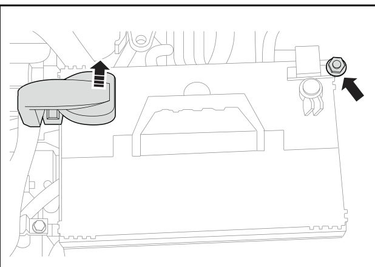
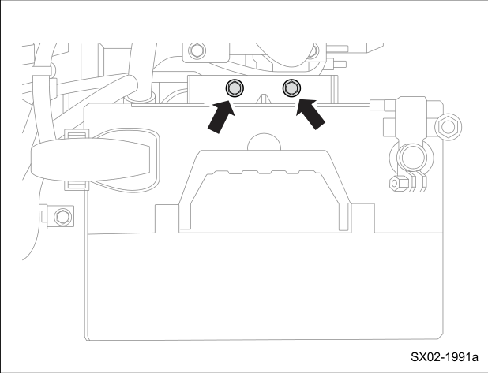
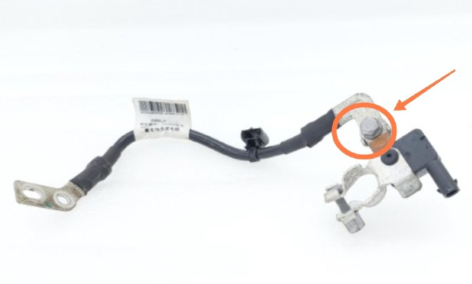

# Аккумулятор Geely Coolray / Belgee X50

Характеристики аккумулятора Coolray (SX11) и Belgee X50, как его снять и поставить, зачем нужен датчик IBS и что проверить, если АКБ садится. Данные — из руководства по эксплуатации, [руководства Geely Coolray 2026](https://cdn.perxis.ru/originals/d8fd7tobeucc73ceqlf0/original) (стр. 195), Service Manual Geely Coolray 2019 и опыта владельцев из [Telegram-сообщества](https://t.me/CoolRay_Android_Develop).

<nav class="toc" id="оглавление" markdown="1">
## Оглавление
{:.no_toc .toc-title #toc-title}

* TOC
{:toc}
</nav>

## Характеристики аккумулятора

Coolray и Belgee X50 белорусской сборки (для России и Беларуси) комплектуются европейским аккумулятором:

| Параметр | Значение |
| --- | --- |
| Напряжение | 12 В |
| Ёмкость | 60 А·ч |
| Полярность | обратная — плюс справа (маркировка R+ или «0») |
| Типоразмер корпуса | L2 (стандартный европейский, около 242 × 175 × 190 мм) |
| Тип | необслуживаемый |
| Расположение | моторный отсек, крепится прижимной пластиной |

Производитель штатной батареи менялся. По отчётам владельцев, на машинах ранних лет стоял **AKOM 60 А·ч**. С 2025 года на конвейер «БелДжи» для Belgee X50 поставляется **ULTRA BELGEE 60Ah R+** белорусского завода «Зубр Энерджи» (та же группа 1AK, что и AKOM) — [сообщение производителя](https://spark.ru/startup/1ak-group/blog/252065/akkumulyatori-dlya-belgee-x50-proizvodstva-1ak-zubr-ooo-ldquo-zubr-enerdzhi-rdquo).

> В Service Manual Geely Coolray 2019 указана батарея другого рынка — азиатского стандарта 90D26L: 80 А·ч, пусковой ток 660 А (BCI, −18 °C). На машинах белорусской сборки стоит европейская 60 А·ч, поэтому ориентируйтесь на свою батарею под капотом.

Руководство по эксплуатации требует ставить аккумулятор того же типа и с теми же характеристиками, что и штатный.

_[К оглавлению](#оглавление)_

## Как снять и поставить аккумулятор

Аккумулятор стоит в моторном отсеке и прижат пластиной.

**Снятие:**

1. Выключите всё электрооборудование и переведите зажигание в OFF.
2. Отверните гайку **минусовой** клеммы и снимите провод.
3. Откройте защитный колпачок плюсовой клеммы, отверните гайку и снимите провод.
4. Отверните гайку прижимной пластины и выньте аккумулятор.

{: width="618" height="440" loading="lazy"}

_Клеммы: колпачок плюсовой клеммы и гайка минусовой клеммы (стрелки). Схема из Service Manual Geely Coolray 2019._

{: width="618" height="473" loading="lazy"}

_Прижимная пластина держится на двух гайках (стрелки)._

**Установка** — в обратном порядке: сначала **плюс**, потом **минус**.

| Что затянуть | Момент |
| --- | --- |
| Гайки клемм (M6) | 9 Н·м (допуск 8–10) |
| Гайка прижимной пластины | 23 Н·м |
| Болты кронштейна АКБ (6 шт.) | 23 Н·м |

Моменты — по Service Manual Geely Coolray 2019, раздел 2.11.

**После замены аккумулятора** в блок управления двигателем записывают конфигурацию датчика АКБ: Launch или дилерский сканер → Engine system → Special function → «Write battery sensor configuration information», выбрать конфигурацию, которая соответствует новой батарее. Текущую конфигурацию можно прочитать там же пунктом «Read battery sensor configuration information».

_[К оглавлению](#оглавление)_

## Датчик IBS

{: width="800" height="481" loading="lazy"}

_Минусовой провод в сборе: клемма с датчиком IBS (чёрный блок с разъёмом). Обведён болт, которым клемма прикручена к проводу. Фото из [Telegram-чата](https://t.me/CoolRay_Android_Develop/71060/462335)._

На минусовой клемме стоит **датчик аккумулятора IBS**. Он измеряет ток, напряжение и температуру АКБ и передаёт их блоку управления двигателем, а тот регулирует напряжение генератора. Питание датчика — через предохранитель **EF33 на 5 А** в моторном отсеке ([схема блоков](/pages/fuses/)).

- Ошибка **P143100** — «Неисправность датчика или аккумуляторной батареи»: проверяют проводку, датчик и предохранитель EF33.
- Если датчик не знает, что батарея новая, он может недозаряжать её — поэтому после замены АКБ записывают конфигурацию (см. выше).

_[К оглавлению](#оглавление)_

## Если аккумулятор не держит заряд

1. **Проверьте клеммы.** Ослабленная гайка или окисленный контакт дают те же симптомы, что и слабая батарея. Окислы зачищают, клеммы смазывают техническим вазелином. Клемма массы — двухсоставная: проверьте и болт, которым она прикручена к самому проводу (обведён на фото выше). У одного из владельцев «садящийся» аккумулятор оказался исправным — был ослаблен именно этот болт.
2. **Проверьте утечку тока.** Снимите минусовую клемму и подключите мультиметр в разрыв (максимальный предел по току). Закройте двери, поставьте машину на охрану и подождите не меньше 10 минут. **Норма — не больше 30 мА.** Больше — ищите потребитель: в первую очередь видеорегистраторы, усилители и другое доустановленное оборудование.
3. **Проверьте возраст батареи.** По отчётам владельцев, штатный аккумулятор живёт 2–3,5 года.
4. **Длительная стоянка.** Если машина стоит без движения неделями, руководство советует снять минусовую клемму.

Пуск стартером — не дольше 5 секунд, пауза между попытками — не меньше 15 секунд.

_[К оглавлению](#оглавление)_

## Как проверить и зарядить аккумулятор

**Напряжение.** По Service Manual (раздел 2.11) при проверке системы пуска напряжение аккумулятора должно быть не ниже **11 В**, а во время прокрутки стартером — не ниже **10,5 В**. Если ниже — батарею заряжают и только потом ищут другие причины.

**Лампа зарядки.** Красный значок аккумулятора на приборке загорается при включении зажигания и гаснет после пуска двигателя — это норма. Если он горит при работающем двигателе, неисправна система зарядки: генератор, его ремень или проводка ([все значки](/pages/warning-lights/)).

**Зарядка снятой батареи** (по Service Manual):

- Заряжайте при комнатной температуре. Холодный аккумулятор может несколько часов почти не принимать заряд.
- Проверяйте батарею каждые полчаса и заряжайте, пока зарядное устройство не покажет полный заряд.
- Если батарея разряжена в ноль (меньше 10 В), ток заряда сначала будет слабым — это ещё не значит, что она умерла. Service Manual предписывает заряжать большим током при напряжении выше 16 В не меньше 4 часов. Если ток заряда так и не появился — аккумулятор под замену.

**Зимой.** Руководство Geely Coolray 2026 советует не допускать полной разрядки аккумулятора в мороз — электролит может замёрзнуть, — избегать глубокого разряда и перезаряда и при низком напряжении вовремя заряжать батарею внешним зарядным устройством. Снятый аккумулятор перевозят и хранят только крышкой вверх.

_[К оглавлению](#оглавление)_

## Как прикурить от другой машины

1. Выключите зажигание и все потребители на обеих машинах.
2. Красный провод (+): к плюсу разряженной батареи, затем к плюсу заряженной.
3. Чёрный провод (−): к минусу заряженной батареи, затем к **неокрашенному металлу двигателя** разряженной машины — не к её минусу.
4. Заведите машину-донора и дайте ей поработать на холостых не меньше 4 минут, затем пробуйте завести разряженную.
5. Отсоединяйте в обратном порядке: сначала минусовые провода, потом плюсовые.

Заводить машину с толкача или буксиром руководство запрещает — это может её повредить.

_[К оглавлению](#оглавление)_

## Частые вопросы

### 🔋 Какой аккумулятор стоит на Geely Coolray / Belgee X50?
На машинах белорусской сборки — европейский 12 В 60 А·ч в корпусе L2 с обратной полярностью (плюс справа). Ранние машины комплектовались AKOM 60 А·ч, с 2025 года на Belgee X50 ставят ULTRA BELGEE 60Ah R+.

### ➕ Какая полярность у аккумулятора?
Обратная: плюсовая клемма справа, если смотреть на батарею со стороны клемм. Обозначается R+ или «0».

### 🔧 Что сделать после замены аккумулятора?
Затянуть клеммы моментом 9 Н·м, прижимную пластину — 23 Н·м, и записать конфигурацию датчика АКБ сканером (Engine system → Special function → Write battery sensor configuration information).

### 📉 Какая утечка тока считается нормальной?
По Service Manual — не больше 30 мА после того, как машина встала на охрану и прошло 10 минут.

### ⚡ Какое напряжение должно быть у аккумулятора?
По Service Manual — не ниже 11 В на стоянке и не ниже 10,5 В во время прокрутки стартером. Ниже — аккумулятор нужно зарядить.

### 🪫 Почему не заряжается сильно разряженный аккумулятор?
Если напряжение упало ниже 10 В, ток заряда сначала очень слабый. Service Manual предписывает заряжать такую батарею большим током не меньше 4 часов, и только если ток так и не появился — менять.

_[К оглавлению](#оглавление)_

------

[Предохранители](/pages/fuses/) · [Все запчасти и каталоги](/pages/parts/) · [Вернуться на главную](/)
