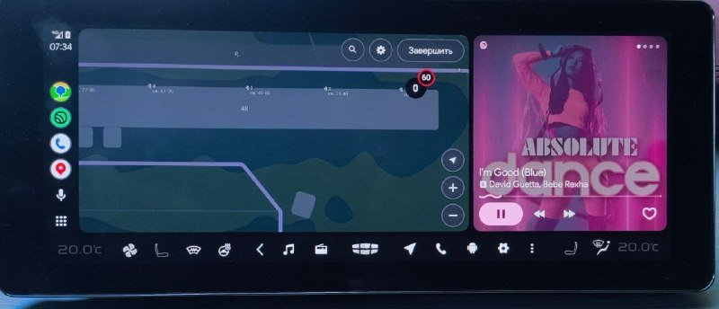
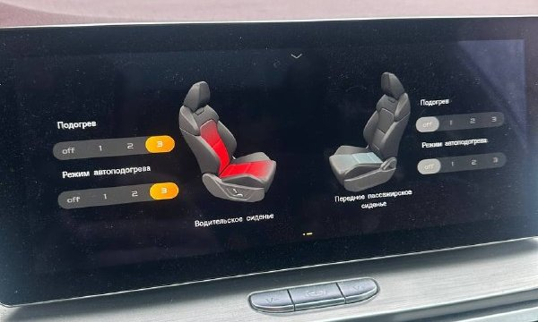
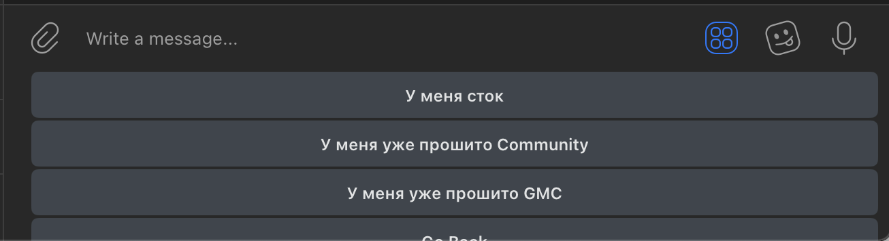
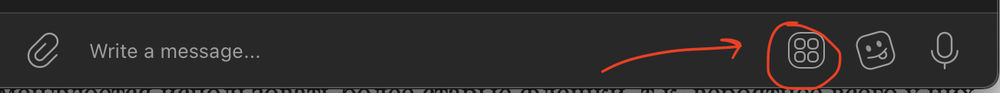
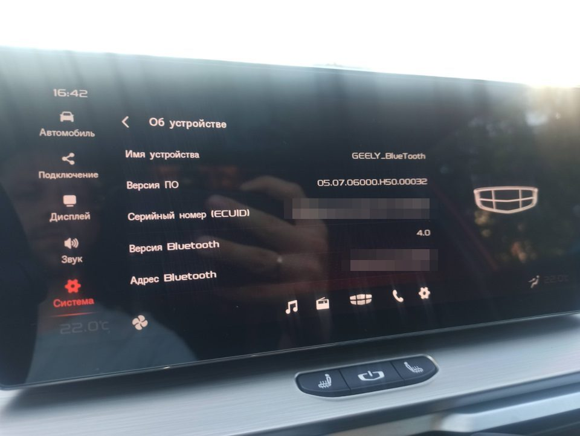
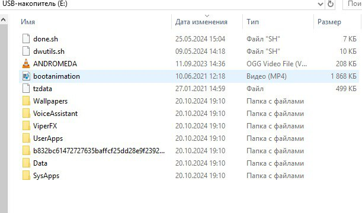

{::options toc_levels="2" /}

# Прошивка магнитолы Geely Coolray / Belgee X50 — Community: скачать, установить, откатить

Community — неофициальная прошивка штатной магнитолы (головного устройства, ГУ) дорестайлинговых Geely Coolray и Belgee X50 на Android 4.3. Скачивается только через бота [@Coolray_Community_helper_bot](https://t.me/Coolray_Community_helper_bot), ставится с флешки за 5–7 минут, откатывается так же.

{: width="800" height="344" loading="lazy"}

_Так выглядит магнитола с Community: внизу панель с кнопками обогревов, «Назад», навигации и настроек, на экране — Android Auto через Headunit Revived. Фото из [Telegram-чата](https://t.me/CoolRay_Android_Develop/70989/451011)._

<nav class="toc" id="оглавление" markdown="1">
## Оглавление
{:.no_toc .toc-title #toc-title}

* TOC
{:toc}
</nav>

## О Community

### Что такое Community?
Пакет модифицированных системных компонентов и дополнительных приложений, который расширяет возможности ГУ. Собран энтузиастами и, в отличие от GMC, не является полноценной прошивкой.

### Что обновится после установки Community Full?
Главное:
+ нижняя панель с кнопками обогревов, «Назад», навигации (Яндекс Навигатор) и настроек; окно климата больше не всплывает от физических кнопок, в нём появляются режимы автоподогрева;
+ дата, время и значок Wi-Fi в верхней строке, панель быстрых кнопок BT / Wi-Fi / точка доступа;
+ новый лаунчер с виджетами и папками, виджет навигации и [стрелки на приборке](/pages/cluster-navigation/);
+ ES Проводник, галерея QuickPic, ViPER4Android (без root), голосовое управление, обои;
+ установка сторонних приложений, московский часовой пояс, без автозапуска радио и окна про ПДД.

{: width="600" height="360" loading="lazy"}

_Окно климата с режимом автоподогрева. Фото из [Telegram-чата](https://t.me/CoolRay_Android_Develop/60768/464763)._

Полный список изменений с именами файлов

+ **Системные приложения (папка SysApps):**
  + русское инженерное меню _[KC2_EngineerMode.apk]_;
  + дата, время и значок Wi-Fi в верхнем статус-баре _[KC2_statusbar.apk]_;
  + нижний навигационный бар с кнопками обогревов, «Назад», навигации (Яндекс Навигатор, если установлен), настроек Geely и Android и контекстного меню; окно климата не всплывает от физических кнопок и ручек (открывается свайпом вверх от нижнего края), в нём режимы автоподогрева _[KC2_SystemUI.apk]_;
  + настраиваемая левая панель быстрых переключателей BT, Wi-Fi и Hotspot _[KC2_EcarxSettingWidget.apk, XCControlBoard.apk]_;
  + без автозапуска радио, окна про ПДД и выбора режима флешки _[KC2_popview.apk]_;
  + лаунчер Home с виджетами, папками и удалением приложений с рабочего стола, стоковый Launcher3 замораживается _[XCLauncher3.apk]_;
  + виджет навигации и стрелки на приборной панели _[KC2_IPKServer.apk, XCNaviService.apk, Community.apk]_ — приборку нужно закодировать, [как вывести стрелки](/pages/cluster-navigation/).
+ **Пользовательские приложения (папка UserApps):** ES Проводник _[ES.apk]_, виджет очистки памяти _[XCAutoSecure.apk]_, виджет даты, времени и погоды _[CoolWidget_1.4.apk]_, офлайн-галерея QuickPic вместо стоковой _[QuickPic_4.7.4_Geely.apk]_, ViPER4Android FX 2.4.0.1 с профилями, драйвер регистрируется без root _[ViperFX]_, голосовое управление _[VoiceAssistant]_, настройки приложений под ГУ _[Data]_, обои _[Wallpapers]_.
+ **Система:** меню разработчика и установка сторонних приложений; отладка по USB отключается; часовой пояс GMT+8 меняется на GMT+3, база поясов обновляется до 2021a _[tzdata]_; рингтон iPhone _[ANDROMEDA.ogg]_; анимация загрузки Community _[bootanimation.mp4]_.

Пакет ставится и поверх старого Community: приложения, ранее установленные как системные, переносятся в пользовательские. Лог установки сохраняется на флешку (файл ГГГГММДД-ЧЧММ.log). Состав пакета настраивается в файле _[done.sh]_.

### Облегченные версии Community
Community Lite — облегчённые пакеты для работы с телефоном. Из полного пакета в них есть системные настройки, часовые пояса, рингтон, верхняя строка, нижняя панель с автоподогревами и отключение автозапуска радио.

| Пакет | Дополнительно | Стрелка на панели открывает |
| --- | --- | --- |
| Lite для Android Auto | ES Проводник, Headunit Reloaded 7.0.4, KeyRemap 1.24.1 | Headunit Reloaded |
| Lite для CarPlay | ES Проводник, AutoKit для донгла [Carlinkit](/pages/carlinkit/) | AutoKit |

### Можно ли что-то убрать из Community?
Да. Перед установкой удалите с флешки ненужные файлы — их имена указаны в квадратных скобках в [полном списке](#что-обновится-после-установки-community-full). Например, без _bootanimation.mp4_ останется заводская анимация загрузки.

### Где найти дополнительные улучшения для Community?
В боте: **У меня уже прошито Community → Дополнительные пакеты**.

### Установится ли Community на Belgee X50?
Только на дорестайлинговые машины со старым ГУ на Android 4.3 — [как узнать, какое ГУ у вас](/pages/versions/#головное-устройство-старое-или-новое). На новое ГУ с Android 9 (бело-синий интерфейс) ставят [Lunaris](https://lunaris-firmware.ru/ru/прошивки/belgee-x50) и [LunarisApp](https://blog.mark99.ru/lunarisapp-dlya-belgee-x50-na-novom-gu/).

_[К оглавлению](#оглавление)_

## Как скачать Community

### Где скачать последнюю версию Community?
Только в боте [@Coolray_Community_helper_bot](https://t.me/Coolray_Community_helper_bot). Пакет один для всех версий ГУ, особенности есть только у ревизии H30 младше 84-й — бот подскажет. Тема на 4PDA устарела и не обновляется.

### Как пользоваться ботом?
Нажимайте кнопки в боте.

{: width="1306" height="356" loading="lazy"}

Если кнопок не видно, нажмите на значок:
{: width="1302" height="122" loading="lazy"}

_[К оглавлению](#оглавление)_

## Установка Community

### Пошаговая инструкция по установке
1. [Узнайте версию ПО](#как-узнать-версию-по-в-машине).
2. В боте выберите **У меня сток** и свою версию ГУ, скачайте архив на компьютер.
3. [Подготовьте флешку](#какая-флешка-нужна-для-установки-community) и [распакуйте на неё архив](#как-правильно-разархивировать-файлы-на-флешку).
4. Вставьте флешку в любой USB-порт машины — левый или правый, не важно.
5. Подождите 5–7 минут: после установки ГУ перезагрузится само.

### Как узнать версию ПО в машине?
На ГУ: ⚙️ → **Система → О системе → Версия ПО**. Нужны символы после буквы H, например H50.00032.

{: width="960" height="721" loading="lazy"}

### Какая флешка нужна для установки Community?
Объёмом 2–8 ГБ, файловая система FAT32, разметка MBR. Старые флешки обычно уже так отформатированы.

### Как правильно разархивировать файлы на флешку?
Распакуйте архив в отдельную папку на компьютере и скопируйте всё её содержимое в корень флешки.

{: width="611" height="360" loading="lazy"}

### Почему после установки Community сбивается дата на 2016 год?
ГУ берёт дату и время с приборной панели. Выставляйте их в меню приборки кнопками на руле, а не в настройках ГУ, — иначе через пару минут дата снова сбросится. С неверной датой не проходит активация приложений, например QDLink.

### Как обновить Community до последней версии?
Скачайте свежий пакет в боте и установите поверх, как в первый раз.

_[К оглавлению](#оглавление)_

## Установка доп. приложений

### Как установить доп. приложения вместе с установкой Community?
Перед установкой скопируйте нужные .apk в папку **UserApps** на флешке.

### Как установить доп. приложения после установки Community?
Скопируйте .apk на флешку, вставьте её в машину, откройте ES Проводник на ГУ, выберите флешку в левом меню и нажмите на приложение. Подборка проверенных приложений — на странице [Приложения для ГУ](/pages/apps/).

_[К оглавлению](#оглавление)_

## Откат и гарантии

### Лишает ли установка Community гарантии?
Формально да. С проблемами ГУ (камеры и т. п.) к дилеру нужно ехать с заводской прошивкой. В остальных случаях дилеры, скорее всего, Community проигнорируют.

### Как откатить изменения и вернуть заводские настройки?
Скачайте архив «H… to stock.zip» для своей версии ГУ, распакуйте на флешку и вставьте её в машину — через 5–7 минут магнитола вернётся в заводское состояние. Если стоит KingRoot, сначала снимите root. Все архивы и частичный откат (ES, Viper, AutoKit) — на странице [Как вернуть заводскую прошивку](/pages/rollback/).

_[К оглавлению](#оглавление)_

------

[Вернуться на главную](https://qttc.github.io/)
