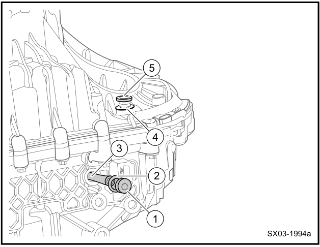

# Робот 7DCT Geely Coolray / Belgee X50: режимы, масло, перегрев

Как устроена 7-ступенчатая роботизированная коробка Coolray и Belgee X50, как ей пользоваться, чтобы она служила дольше, как поменять масло и что значат предупреждения о перегреве. Данные — из руководства по эксплуатации, Service Manual Geely Coolray 2019 и опыта владельцев из [Telegram-сообщества](https://t.me/CoolRay_Android_Develop).

> Руководство и Service Manual описывают Coolray до рестайлинга с мотором JLH-3G15TD и Belgee X50 — это одна платформа SX11. У рестайлингового Coolray 2023+ другой мотор; объёмы и моменты ниже для него не сверены.

<nav class="toc" id="оглавление" markdown="1">
## Оглавление
{:.no_toc .toc-title #toc-title}

* TOC
{:toc}
</nav>

## Что за коробка

| Параметр | Значение |
| --- | --- |
| Тип | 7-ступенчатая роботизированная с двумя **мокрыми** сцеплениями (7DCT) |
| Обозначение | 7DCT330 — по входному моменту до 330 Н·м |
| Разработчик | Geely |
| Масса | 81 кг |
| Привод сцеплений | электрогидравлический: два привода со своими блоками управления и бачками |
| Охлаждение | электрический масляный насос и маслоохладитель, охлаждаемый антифризом двигателя |

Одно сцепление включает нечётные передачи и задний ход, второе — чётные. В руководствах по эксплуатации коробка называется просто 7DCT.

_[К оглавлению](#оглавление)_

## Какие коробки бывают на Coolray и Belgee X50

В России и Беларуси почти все версии — с роботом 7DCT. Исключение одно: атмосферный Belgee X50 2026 года с классическим автоматом.

| Машина | Мотор и коробка | Масло в коробке |
| --- | --- | --- |
| Coolray 2020–2023, Belgee X50 (с 2023) | 1,5 турбо, 3 цилиндра, JLH-3G15TD; робот 7DCT | Shell Spirax S5 DCT10, 4,0 л |
| Coolray рестайлинг (2023–2025) | 1,5 турбо, 4 цилиндра, BHE15-AFZ (147 л. с.) или BHE15-EFZ (128 кВт / 290 Н·м); робот 7DCT | Shell Spirax High Perf HDCTF: 3,3 л с заменой фильтра коробки, 2,7 л без |
| Belgee X50+, Coolray 2026 | 1,5 турбо, 4 цилиндра, BHE15-AFZ (147 л. с.); робот 7DCT | в руководстве не указано |
| Belgee X50 атмосферный (2026) | 1,5 без турбины, 4 цилиндра, BHE15-AFD (122 л. с.); **6AT** — 6-ступенчатый автомат с гидро&shy;трансформатором | в руководстве не указано |

- **Механики** в России и Беларуси не было: по данным прессы, робот стоял «во всех модификациях», а во всех руководствах для этих рынков указаны только 7DCT или 6AT.
- **Мотор 1.4** у нас тоже не продавался. 1,4-литровый турбомотор (141 л. с.) ставили только на китайский Geely Binyue в 2020–2023 годах — с 6-ступенчатой механикой или 6-ступенчатым роботом.
- Всё остальное на этой странице — про робот 7DCT дорестайлингового Coolray и Belgee X50.

_[К оглавлению](#оглавление)_

## Режимы P, R, N, D, M

| Режим | Как включить и что важно |
| --- | --- |
| **P** — паркинг | отдельной кнопкой P, только на стоящей машине. Колёса блокируются механически. Коробка сама переходит в P при выключении зажигания |
| **R** — задний ход | только на стоящей машине: тормоз + кнопка разблокировки на рычаге |
| **N** — нейтраль | из N в D — тормоз; из N в R — тормоз + кнопка разблокировки |
| **D** — движение | тормоз + кнопка разблокировки из P; при отпущенном тормозе машина ползёт |
| **M** — ручной | из D сдвинуть рычаг влево; вперёд — передача вверх, назад — вниз |

- **Двигатель запускается только в P или N**, с нажатым тормозом.
- **Подрулевые лепестки** (не во всех комплектациях): правый — вверх, левый — вниз. Нажатие в D включает временный ручной режим; выход — удерживать «+» 1 секунду или подождать.
- **SPORT** переключает передачи вверх позже, **ECO** — раньше. Не включаются в M и при горячем масле коробки.

_[К оглавлению](#оглавление)_

## Как не убить коробку

Что прямо запрещает или не советует руководство:

- **Не стоять в D, R или M на тормозе** даже коротко — это сокращает ресурс. На короткой остановке — N и электронный ручник, на долгой — ручник и P.
- **Не держать машину газом на подъёме** — коробка перегревается.
- **Не катиться накатом в N** — коробке не хватает смазки.
- Не газовать при переключении селектора и пока передача не включилась; после пуска подождать 3 секунды.
- В снегу раскачивать машину без долгой пробуксовки.
- Не глушить двигатель на ходу с включённой передачей.

### Ручник, AUTO HOLD и помощь на подъёме

- **Электронный ручник (EPB)** включается сам при переходе в P и выключении зажигания. Сам отпускается, если двигатель работает, дверь водителя закрыта, ремень пристёгнут и вы плавно нажали газ.
- **Режим мойки:** чтобы ручник не включился, удерживайте клавишу EPB перед выключением зажигания.
- **AUTO HOLD** держит машину после отпускания тормоза до нажатия газа. Руководство предупреждает: при большой нагрузке машина может скатиться и с AUTO HOLD.
- **Помощь при трогании на подъёме (HHC)** держит тормоз только **около 2 секунд** после отпускания педали.

Если коробка не переключается выше второй передачи, проверьте, не горят ли постоянно стоп-сигналы — [подробнее](/pages/problems/#коробка-не-переключает-скорости-вверх).

_[К оглавлению](#оглавление)_

## Масло в коробке

| Параметр | Значение |
| --- | --- |
| Жидкость | Shell Spirax S5 DCT10 — единственная указанная в руководстве |
| Объём | 4,0 л |
| Интервал замены | 80 000–90 000 км или 4 года, что наступит раньше |
| Пробки сливная и заливная | 40 Н·м, новые прокладки |
| Мерная трубка | 6 Н·м |

Это данные для Coolray до рестайлинга и Belgee X50. У рестайлингового Coolray 2023 другая жидкость — Shell Spirax High Perf HDCTF, 3,3 л с заменой фильтра коробки или 2,7 л без.

В Service Manual встречается и **4,5 л** — это объём новой, сухой коробки. При замене часть масла остаётся внутри, поэтому заливают меньше. Другие допуски и проверенные владельцами масла — на странице [масел и жидкостей](/pages/oil/#масло-в-коробку-допуски-и-объём).

### Как поменять масло

{: width="628" height="486" loading="lazy"}

_1 — сливная пробка, 2 — прокладка, 3 — мерная трубка, 4 — прокладка, 5 — заливная пробка. Схема из Service Manual Geely Coolray 2019, раздел 3.1.7.1._

По Service Manual:

1. Выкрутите сливную пробку (1) и мерную трубку (3) за ней — масло стечёт.
2. Выкрутите заливную пробку (5) — стечёт ещё. Подождите 15 минут.
3. **Измерьте, сколько слилось** — столько и заливать.
4. Закрутите заливную пробку (5) с новой прокладкой — 40 Н·м, мерную трубку (3) — 6 Н·м.
5. Заливайте через отверстие сливной пробки, пока масло не начнёт вытекать из него.
6. Закрутите сливную пробку (1) с новой прокладкой — 40 Н·м.

Разные масла смешивать нельзя, слитое масло повторно не используют.

По опыту владельцев, при замене сливается **от 2,7 до 4 л** — берут 4 л и заливают до перелива. Аппаратная замена не нужна, хватает одного слива и заливки. Фильтр внутри коробки и меняется только при разборке.

### Бачки приводов сцеплений

У каждого из двух приводов сцеплений свой бачок с жидкостью. Регламента её замены нет, процедуры в Service Manual тоже. Часть владельцев откачивает по 60–70 мл из каждого бачка и доливает то же масло, что в коробку; другие только проверяют уровень, чтобы не завоздушить систему.

_[К оглавлению](#оглавление)_

## Нужна ли адаптация

Процедуры адаптации после замены масла в Service Manual нет — блок управления коробкой подстраивается сам. По опыту владельцев и сервисов, после замены масла адаптация не нужна: «заменили, сел и поехал».

При жалобах на пинки дилеры делают адаптацию сканером и обновляют прошивку блока коробки.

_[К оглавлению](#оглавление)_

## Перегрев и ошибки

**Лампа неисправности коробки:** жёлтая — незначительная неисправность, красная — серьёзная. Загорелась — снизьте скорость и езжайте в сервис. При серьёзной неисправности коробка переходит в **аварийный режим**: горит лампа двигателя, на приборке — «Аварийный режим работы коробки передач». В этом режиме можно доехать до сервиса. Значки — в разделе [значков на приборной панели](/pages/warning-lights/).

**При перегреве** блок коробки выводит предупреждение на приборку и подаёт звуковой сигнал. По опыту владельцев, на приборке появляется оранжевая шестерёнка и «Перегрев КПП: нужен сервис». Остановитесь и дайте коробке остыть; частая причина — долгое стояние на тормозе в D и удержание машины газом на подъёме.

Коды перегрева по Service Manual:

| Код | Что значит |
| --- | --- |
| P021800 | масло коробки горячее 135 °C |
| P27874B | сцепление 1 горячее 240 °C |
| P17014B | сцепление 2 горячее 240 °C |
| P081100 / P081E00 | длительное проскальзывание сцепления 1 / 2 |
| P28577A / P28597A | утечка в гидролинии сцепления 1 / 2 |
| P278800 | ограниченная адаптация коробки |

При P021800 Service Manual велит проверить по порядку: другие ошибки, уровень и состояние масла коробки, уровень антифриза, маслоохладитель коробки и его трубки, систему охлаждения двигателя, затем датчик, проводку и блок коробки.

По опыту владельцев: при пинках на 4→5 и 6→7 и сообщении о перегреве замена масла и адаптация не помогли — дилер нашёл низкое давление в гидравлике и заменил блок приводов сцеплений.

Предохранители коробки — SB04 и SB06 (7DCT1, 7DCT2, 30 А), EF01 и EF02 (питание приводов сцеплений, 30 А), EF03 (TCU/EMS, 10 А) — см. [схему предохранителей](/pages/fuses/).

_[К оглавлению](#оглавление)_

## Частые жалобы

- **Пинки и подёргивания на холодную**, пока коробка не прогрелась, — самая типичная жалоба. Лечат адаптацией и прошивкой блока коробки; по опыту владельцев, пинки уходили и после замены масла.
- **Толчки на малой скорости** при медленном разгоне и торможении, толчок при переключении 1→2 — по опыту владельцев.
- **Откаты на подъёме** — помощь при трогании держит машину только около 2 секунд; дальше нужно успеть нажать газ.

Ресурс коробки эксперты оценивают в 200–270 тыс. км; раннего износа сцеплений не отмечают.

_[К оглавлению](#оглавление)_

## Буксировка

- На гибкой сцепке 4–10 м: селектор в **N**, аварийка на обеих машинах, **не быстрее 50 км/ч и не дальше 50 км**.
- На эвакуаторе — **только с поднятыми передними колёсами**.
- Если в коробке нет масла или ехать дальше 50 км — только эвакуатор.
- Заводить с толкача или буксиром нельзя.

Буксировочная проушина лежит в багажнике и вкручивается справа в передний или задний бампер. Всё — по руководству.

_[К оглавлению](#оглавление)_

## Частые вопросы

### ⚙️ Какая коробка стоит на Geely Coolray?
7-ступенчатый робот 7DCT с двумя мокрыми сцеплениями, обозначение 7DCT330 — входной момент до 330 Н·м. Разработка Geely. Он стоит на всех Coolray и Belgee X50 с турбомотором, включая рестайлинг, X50+ и Coolray 2026.

### 🕹️ Бывает ли Coolray или Belgee X50 с механикой или мотором 1.4?
В России и Беларуси — нет: только робот 7DCT, а у атмосферного Belgee X50 2026 — автомат 6AT. Мотор 1.4 турбо и механика были только у китайского Geely Binyue.

### 🚗 Какая коробка у Belgee X50 с атмосферным мотором?
Классический 6-ступенчатый автомат 6AT с гидротрансформатором, в паре с мотором BHE15-AFD на 122 л. с. Какое масло в него заливать, в руководстве по эксплуатации не указано.

### 🛢️ Сколько масла в коробке 7DCT?
По руководству — 4,0 л Shell Spirax S5 DCT10. 4,5 л — это объём новой сухой коробки. При замене, по опыту владельцев, сливается 2,7–4 л; заливают столько же, до перелива из контрольного отверстия.

### 📅 Как часто менять масло в коробке?
По Service Manual — каждые 80 000–90 000 км или раз в 4 года, что наступит раньше.

### 🔄 Нужна ли адаптация после замены масла в коробке?
В Service Manual процедуры нет, блок коробки подстраивается сам. По опыту владельцев и сервисов — не нужна.

### 🌡️ Что делать, если пишет «Перегрев КПП»?
Остановитесь и дайте коробке остыть. Не стойте в D на тормозе и не держите машину газом на подъёме. Если сообщение повторяется — в сервис: проверить масло, маслоохладитель и гидравлику сцеплений.

### 🚚 Можно ли буксировать Coolray с роботом?
Да, на гибкой сцепке в N — не быстрее 50 км/ч и не дальше 50 км. На эвакуаторе — только с поднятыми передними колёсами.

_[К оглавлению](#оглавление)_

------

**Источники**

- Руководства по эксплуатации, моторы, коробки и жидкости: [Coolray 2023](https://cdn.perxis.ru/originals/d1elmp8beucc73er1hd0/original), стр. 227–228, 231 (в том числе Shell Spirax High Perf HDCTF, 3,3 и 2,7 л); [Belgee X50+](https://cdn.perxis.ru/originals/d8632e8beucc73ceoa10/original), стр. 178–180; [Coolray 2026](https://cdn.perxis.ru/originals/d8fd7tobeucc73ceqlf0/original), стр. 205–206; [Belgee X50 2026](https://cdn.perxis.ru/originals/db2g9t8beucc73boua9g/original), стр. 118–120.
- Руководство по эксплуатации дорестайлингового Coolray: режимы — стр. 167–172; что запрещает руководство — стр. 162, 170–171, 228; ручник и AUTO HOLD — стр. 174–180; буксировка — стр. 208–209.
- Service Manual Geely Coolray 2019: тип и устройство коробки — раздел 3.1.
- Автомат 6AT с гидротрансформатором: [брошюра Belgee X50](https://cdn.perxis.ru/originals/dapu0ugbeucc7399i5pg/original), [Колёса.ру](https://www.kolesa.ru/news/popolnenie-v-rossiiskoi-lineike-u-krossovera-belgee-x50-poiavitsia-versiia-s-novoi-texnikoi).
- Статьи: [«За рулём» о ресурсе робота](https://www.zr.ru/content/articles/960251-skolko-prosluzhit-robot-geely-i-chery-prognoz/) — обозначение 7DCT330; [auto.ru о надёжности Coolray](https://auto.ru/mag/article/vsyo-o-nadyozhnosti-geely-coolray-i-pokoleniya-harakternye-problemy-kompaktnogo-krossovera/) — обозначение 7DCT330, пинки на холодную, адаптация и прошивка; [«За рулём» о неисправностях](https://www.zr.ru/content/articles/965970-geely-coolray-2019-neispravnosti/) — адаптация и прошивка при пинках; [«За рулём» о Coolray с пробегом](https://www.zr.ru/content/articles/962849-geely-coolray-s-probegom/) — пинки на холодную, ресурс 200–270 тыс. км; [autonews](https://www.autonews.ru/news/5eb2af8d9a794778e63086e1) — робот во всех модификациях.
- Мотор 1.4 у Geely Binyue: [autohome](https://www.autohome.com.cn/news/202108/1189514.html), [paultan](https://paultan.org/2020/04/20/2020-geely-binyue-pro-to-get-new-1-4t-mill-in-china/).
- Опыт владельцев: сколько сливается при замене масла — чат [1](https://t.me/CoolRay_Android_Develop/71060/442672), [2](https://t.me/CoolRay_Android_Develop/71060/451872), [3](https://t.me/CoolRay_Android_Develop/71060/442737), [отчёт на Drive2](https://www.drive2.ru/l/708819138495133374/); бачки приводов сцеплений — [отчёт на Drive2](https://www.drive2.ru/l/690536459148463278/), [обсуждение в чате](https://t.me/CoolRay_Android_Develop/71060/442707); адаптация после замены масла не нужна — чат [1](https://t.me/CoolRay_Android_Develop/71060/446225), [2](https://t.me/CoolRay_Android_Develop/71060/465085); замена блока приводов сцеплений — [начало](https://t.me/CoolRay_Android_Develop/71060/455469), [итог](https://t.me/CoolRay_Android_Develop/71060/460203); толчки на малой скорости — [обсуждение в чате](https://t.me/CoolRay_Android_Develop/60768/453911).

[Масло и жидкости](/pages/oil/) · [ТО и расходники](/pages/to/) · [Предохранители](/pages/fuses/) · [Все запчасти и каталоги](/pages/parts/) · [Вернуться на главную](/)
