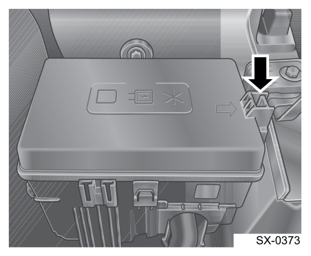
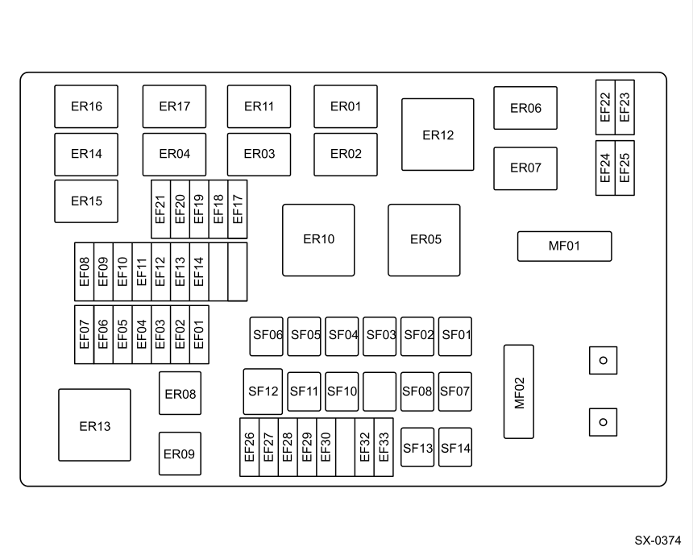
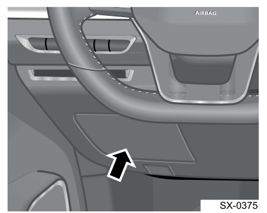
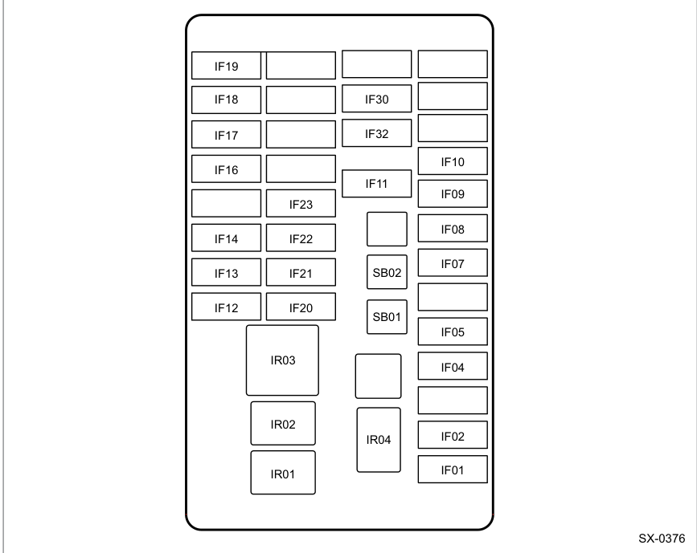

# Предохранители Geely Coolray / Belgee X50: схема и расшифровка

У Coolray (SX11) и Belgee X50 два блока предохранителей: **в моторном отсеке** слева и **в салоне** — в левой части приборной панели, под рулём. Ниже — где они стоят, схемы и что защищает каждый предохранитель. Данные из руководства по эксплуатации Geely Coolray.

> Расположение и номиналы могут отличаться в зависимости от комплектации. Точная схема вашей машины — на внутренней стороне крышки блока.

<nav class="toc" id="оглавление" markdown="1">
## Оглавление
{:.no_toc .toc-title #toc-title}

* TOC
{:toc}
</nav>

## Как быстро найти нужный предохранитель

| Не работает | Предохранитель | Блок | Ток |
| --- | --- | --- | --- |
| Прикуриватель (розетка 12 В) | IF19 | салон | 15 A |
| Магнитола (ГУ, мультимедиа MMI) | IF32, IF17 | салон | 15 A, 10 A |
| Ближний свет | EF22 (левая), EF23 (правая) | мотор | 10 A |
| Дальний свет | EF24 (левая), EF25 (правая) | мотор | 10 A |
| Противотуманные фары | EF27 (левая), EF30 (правая) | мотор | 10 A |
| Стеклоподъёмники | SB11 (левый), SB13 (правый) | мотор | 30 A |
| Звуковой сигнал | EF07 | мотор | 15 A |
| Стоп-сигналы и разъём OBD | EF04 | мотор | 10 A |
| Обогрев заднего стекла | SB14 | мотор | 30 A |
| Обогрев лобового стекла | EF05 | мотор | 25 A |
| Обогрев зеркал | EF21 | мотор | 10 A |
| Подогрев сидений | IF14, EF17, EF32 | салон, мотор | 10–15 A |
| Вентилятор печки | SB10 | мотор | 30 A |
| Кондиционер (компрессор) | EF26 | мотор | 15 A |
| Центральный замок | IF05 | салон | 20 A |
| Электроручник EPB | SB02, SB03 | мотор | 40 A, 50 A |
| Топливный насос | EF06 | мотор | 15 A |
| Дворники: передний / задний | EF28 / IF16 | мотор / салон | 20 A / 10 A |
| Омыватель | IF13 | салон | 15 A |
| Люк | SB02 | салон | 30 A |

_[К оглавлению](#оглавление)_

## Блок предохранителей в моторном отсеке

Стоит в левой части моторного отсека. Откройте капот, отожмите боковую защёлку и снимите крышку.

{: width="452" height="372" loading="lazy"}

{: width="860" height="689" loading="lazy"}

На схеме крупные предохранители подписаны SF01–SF14, а в таблице руководства — SB01–SB14: это одни и те же места.

| № | Что защищает | Ток |
| --- | --- | --- |
| MF01 | электроусилитель руля (EPS) | 80 A |
| MF02 | генератор | 150 A |
| SB01 | питание салонного блока (IP BOX B+) | 60 A |
| SB02 | электронный стояночный тормоз EPB | 40 A |
| SB03 | электродвигатель EPB | 50 A |
| SB04 | коробка 7DCT (1) | 30 A |
| SB05 | стартер | 30 A |
| SB06 | коробка 7DCT (2) | 30 A |
| SB07 | питание салонного блока (IP BOX ALT+) | 60 A |
| SB08 | вентилятор радиатора, низкая скорость | 40 A |
| SB10 | вентилятор салона (печка) | 30 A |
| SB11 | левый стеклоподъёмник | 30 A |
| SB12 | вентилятор радиатора, высокая скорость | 50 A |
| SB13 | правый стеклоподъёмник | 30 A |
| SB14 | обогрев заднего стекла | 30 A |
| EF01 | коробка 7DCT (3) | 30 A |
| EF02 | коробка 7DCT (4) | 30 A |
| EF03 | блоки TCU / EMS | 10 A |
| EF04 | выключатель стоп-сигналов / OBD | 10 A |
| EF05 | обогрев ветрового стекла | 25 A |
| EF06 | топливный насос | 15 A |
| EF07 | звуковой сигнал | 15 A |
| EF08 | электромагнитный клапан | 15 A |
| EF09 | кислородный датчик | 15 A |
| EF10 | катушки зажигания | 15 A |
| EF11 | блок управления двигателем EMS | 25 A |
| EF12 | реле (вентилятор, масляный насос, компрессор, стартер, вакуумный насос) / SOV | 10 A |
| EF13 | обратная связь стартера | 10 A |
| EF14 | реле стартера R2 | 10 A |
| EF17 | подогрев заднего / переднего сиденья | 10 A |
| EF18 | EPB / ESC / датчик педали сцепления | 10 A |
| EF19 | EMS / TCU / датчик нейтрали | 10 A |
| EF20 | блок EPS | 10 A |
| EF21 | обогрев наружных зеркал | 10 A |
| EF22 | ближний свет, левая фара | 10 A |
| EF23 | ближний свет, правая фара | 10 A |
| EF24 | дальний свет, левая фара | 10 A |
| EF25 | дальний свет, правая фара | 10 A |
| EF26 | компрессор кондиционера | 15 A |
| EF27 | левая противотуманная фара | 10 A |
| EF28 | передний стеклоочиститель | 20 A |
| EF29 | EGSM / камеры 360 / светодиод EPB | 10 A |
| EF30 | правая противотуманная фара | 10 A |
| EF32 | подогрев заднего сиденья | 15 A |
| EF33 | датчик аккумулятора IBS | 5 A |

Назначение реле (ER01–ER17) в руководстве не расписано — его можно посмотреть в [электросхемах](/assets/pdf/Принципиальные_электрические_схемы_GEELY_Coolray_SX11.pdf), раздел 13.4 «Предохранители и реле».

_[К оглавлению](#оглавление)_

## Блок предохранителей в салоне

Стоит в левой части приборной панели, под рулём. Чтобы добраться до предохранителей, откройте защитную крышку.

{: width="452" height="361" loading="lazy"}

{: width="867" height="689" loading="lazy"}

| № | Что защищает | Ток |
| --- | --- | --- |
| IF01 | блок BCM / наружные фонари | 30 A |
| IF02 | освещение салона / BCM | 30 A |
| IF04 | зеркало (BCM), подсветка ног, HPS, катушка иммобилайзера | 10 A |
| IF05 | центральный замок / BCM | 20 A |
| IF07 | FCS / EDR | 10 A |
| IF08 | шлюз (gateway) | 5 A |
| IF09 | экран / IN | 5 A |
| IF10 | общая подсветка / TCM | 10 A |
| IF11 | постоянная память | 20 A |
| IF12 | реле вентилятора | 10 A |
| IF13 | моторчик омывателя | 15 A |
| IF14 | подогрев сидений | 10 A |
| IF16 | задний стеклоочиститель | 10 A |
| IF17 | BCM / MMI / зеркало / USB / EDR (ACC) | 10 A |
| IF18 | блок переднего отопителя | 20 A |
| IF19 | розетка 12 В (прикуриватель) | 15 A |
| IF20 | ESCL / ESC / ACC / DCT / парковка / 360 / кнопка EPB | 10 A |
| IF21 | подушки безопасности | 5 A |
| IF22 | BCM / приборная панель / ЭРА-ГЛОНАСС / автозатемнение зеркала / TCM | 10 A |
| IF23 | UEC IG1 | 10 A |
| IF30 | ЭРА-ГЛОНАСС (E-Call) | 10 A |
| IF32 | мультимедиа MMI | 15 A |
| SB01 | электропривод сиденья | 30 A |
| SB02 | люк | 30 A |

_[К оглавлению](#оглавление)_

## Как проверить и заменить предохранитель

1. Выключите зажигание и все потребители, снимите минусовую клемму аккумулятора.
2. Съёмником из крышки блока возьмите предохранитель за головку и вытяните.
3. Посмотрите на перемычку внутри: если она разорвана — предохранитель сгорел.
4. Поставьте новый **того же номинала и цвета**. Цвет пластинчатого предохранителя обозначает ток, номинал также написан на корпусе.

> Если новый предохранитель сразу сгорает — в цепи неисправность, ставить предохранитель большего номинала нельзя: это может привести к перегреву проводки и пожару. Обратитесь в сервис.

Стеклоподъёмник перестал реагировать, хотя предохранитель цел? Сначала попробуйте сброс блока — в [Проблемах и решениях](/pages/problems/#отвал-стеклоподъёмника).

_[К оглавлению](#оглавление)_

## Частые вопросы

### Где находятся предохранители на Geely Coolray / Belgee X50?

Блоков два: в моторном отсеке слева (под крышкой с защёлкой) и в салоне — в левой части приборной панели под рулём, за защитной крышкой.

### Какой предохранитель отвечает за прикуриватель?

IF19 на 15 A в салонном блоке — предохранитель розетки электропитания 12 В.

### Какой предохранитель у магнитолы?

Мультимедиа (MMI) питается через IF32 на 15 A, цепь ACC — через IF17 на 10 A. Оба в салонном блоке.

### Какие предохранители у фар?

В моторном отсеке: ближний свет — EF22 (левая) и EF23 (правая), дальний — EF24 и EF25, противотуманные — EF27 и EF30. Все на 10 A.

### Можно ли поставить предохранитель большего номинала?

Нет. Руководство запрещает ставить предохранитель другого цвета или номинала: проводка перегреется. Если предохранитель горит повторно — ищите неисправность в цепи.

_[К оглавлению](#оглавление)_

------

[Все запчасти и каталоги](/pages/parts/) · [Проблемы и решения](/pages/problems/) · [Вернуться на главную](/)
