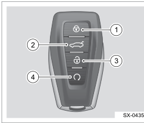
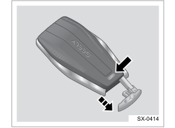
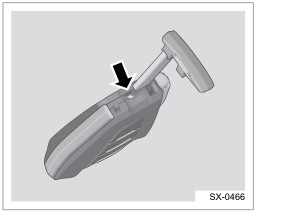
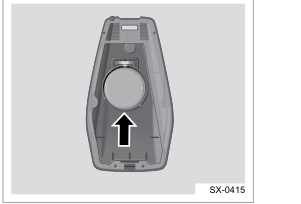

# Ключ Geely Coolray / Belgee X50: батарейка, «ключ не найден», автозапуск

Всё о штатном смарт-ключе: кнопки, замена батарейки, аварийный запуск, когда машина не видит ключ, дистанционный запуск двигателя и прописка нового ключа. Данные — из руководства по эксплуатации Coolray, Service Manual Geely Coolray 2019 и опыта владельцев из [Telegram-сообщества](https://t.me/CoolRay_Android_Develop).

<nav class="toc" id="оглавление" markdown="1">
## Оглавление
{:.no_toc .toc-title #toc-title}

* TOC
{:toc}
</nav>

## Кнопки ключа

{: width="245" height="210" loading="lazy"}

| № | Кнопка | Что делает |
| --- | --- | --- |
| 1 | Замок закрыт | запирает машину; удержание — поднимает стёкла |
| 2 | Багажник | открывает багажник |
| 3 | Замок открыт | отпирает машину; удержание — опускает стёкла |
| 4 | Круговая стрелка | [дистанционный запуск двигателя](#автозапуск-с-ключа); двойное нажатие — 3 сигнала и 3 мигания поворотников, чтобы найти машину |

Удержание кнопки запирания 10 секунд ставит машину на охрану без звука и мигания (Service Manual).

Внутри смарт-ключа спрятан механический ключ: нажмите кнопку на корпусе и вытяните его. Им отпирают водительскую дверь, если сел аккумулятор машины или не работает центральный замок, и включают детский замок задних дверей.

{: width="288" height="210" loading="lazy"}

_Схемы — из руководства по эксплуатации Geely Coolray, стр. 145–146._

Не носите смарт-ключ на одной связке с другими ключами с чипом (от другой машины, от домофона): по руководству, их микрочипы мешают иммобилайзеру и бесключевому доступу, и двигатель может не запуститься.

_[К оглавлению](#оглавление)_

## Батарейка ключа

| Параметр | Значение |
| --- | --- |
| Тип | CR2032, 3 В |
| Как ставить | плюсом (+) вниз |
| Норма напряжения | 2,17–3,6 В (по Service Manual) |

**Когда менять**, по руководству: заметно уменьшилось расстояние, с которого срабатывает ключ, перестало работать дистанционное управление или машина не распознаёт ключ. При низком заряде блок BCM записывает ошибки **B12B216** и **B12B316** («низкий заряд ключа 1/2») — их видно сканером.

По опыту владельцев, при разряде на приборной панели появляется жёлтый значок ключа ([пример в чате](https://t.me/CoolRay_Android_Develop/71060/453451)).

### Как заменить батарейку

1. Достаньте механический ключ.
2. Вставьте его в среднее отверстие корпуса и, удерживая, поверните по часовой стрелке — задняя крышка откроется.

   {: width="301" height="218" loading="lazy"}

3. Замените батарейку: новая CR2032 ставится **плюсом вниз**.

   {: width="301" height="204" loading="lazy"}

4. Соедините две половинки корпуса до щелчка.

_Схемы — из руководства по эксплуатации, стр. 146; то же в Service Manual, раздел 11.9.6.1._

Перевёрнутая батарейка — частая ошибка. По опыту владельцев, ключ после этого перестаёт закрывать машину, а на приборке появляется «ключ не обнаружен»; завести можно только из аварийной зоны. Перевернули по значку «+» на стенке корпуса — всё заработало ([обсуждение](https://t.me/CoolRay_Android_Develop/60768/453601)).

_[К оглавлению](#оглавление)_

## Пишет «ключ не найден»

Двигатель запускается, только если система видит действительный ключ в салоне. Иначе на приборной панели появляется сообщение, что ключа в автомобиле нет. Причины — разряженная батарейка ключа, неисправный ключ или радиопомехи.

Что делать по руководству:

1. **Положите ключ в зону аварийного пуска — на дно бокса центрального подлокотника** — и запустите двигатель кнопкой «Старт/Стоп». Там стоит антенна иммобилайзера, которая читает ключ даже с севшей батарейкой.
2. Не помогло — попробуйте **запасной ключ**. Заводится запасным — неисправен первый ключ. Не заводится ни одним — неисправна система, нужно к дилеру.
3. Уберите рядом с ключом другие ключи с чипом и электронику, которые могут создавать помехи.

Если сел аккумулятор машины, ключ не поможет: дверь открывают механическим ключом, а машину заводят от внешнего источника — см. [прикуривание](/pages/battery/#как-прикурить-от-другой-машины).

Неисправности системы бесключевого доступа BCM пишет кодами: B12A053 (двигатель не разблокирован, сбой авторизации), B12AD29 (нет ответа бесключевого запуска), B12B149 (обрыв антенны иммобилайзера), B128600–B12B000 (обрывы антенн в дверях, салоне, багажнике). Коды — по Service Manual.

_[К оглавлению](#оглавление)_

## Бесключевой доступ

- **Отпереть:** ключ не дальше 1,5 м от передней двери — коснитесь зоны датчика на ручке. Отпираются все двери, поворотники мигают 3 раза.
- **Запереть:** зажигание выключено, двери, капот и багажник закрыты, ключ снаружи — коснитесь зоны запирания на ручке. Поворотники мигают 1 раз. Следующие 5 секунд бесключевое отпирание не работает.
- **Автоповторное запирание:** отперли и за 30 секунд ничего не открыли — машина запрётся снова.
- Ключ остался в салоне или багажнике — при попытке запереть кнопкой на двери звучит сигнал, двери не запираются.

У Belgee X50 в базовой комплектации «Актив» бесключевого доступа нет.

_[К оглавлению](#оглавление)_

## Автозапуск с ключа

Двигатель можно завести с брелока, не подходя к машине:

1. Ключ — в зоне действия.
2. Нажмите кнопку дистанционного запуска (4), затем кнопку запирания (1).
3. Нажмите и удерживайте кнопку дистанционного запуска около 2 секунд.

**Заглушить** — снова нажать и удерживать кнопку дистанционного запуска. Кнопка «отпереть» в этом режиме отпирает машину.

Порядок — по руководству, стр. 150. У [«За рулём»](https://www.zr.ru/content/articles/926671-5-fishek-geely-coolray/) и в чате описан вариант короче: нажать «запереть», затем удерживать кнопку запуска.

По опыту владельцев:

- двигатель работает **10 минут** и глохнет; запустить можно повторно — всего 2 × 10 минут, увеличить время штатно нельзя ([1](https://t.me/CoolRay_Android_Develop/60768/447331), [2](https://t.me/CoolRay_Android_Develop/169864/456612));
- климат включается сам в режиме AUTO, прошлые настройки не сохраняются, подогрев сидений не включается ([обсуждение](https://t.me/CoolRay_Android_Develop/60768/458959));
- головное устройство не загружается до тех пор, пока вы не сядете и не нажмёте тормоз ([обсуждение](https://t.me/CoolRay_Android_Develop/60768/465028)).

На Coolray Link с конца 2022 года есть ещё запуск через приложение G-Link — по таймеру, температуре или заряду АКБ ([auto.ru](https://auto.ru/mag/article/u-geely-coolray-v-rossii-poyavilas-komplektaciya-s-distancionnym-upravleniem/)). Это отдельная функция, к ключу не относится.

_[К оглавлению](#оглавление)_

## Новый ключ и прописка

Потеряли или сломали ключ — по руководству, нужно к официальному дилеру. Дилер отвяжет потерянный ключ от машины, новый изготавливают не сразу.

Как прописывают ключи, по Service Manual:

- через диагностический разъём OBD сканером: BCM → Special function → **IMMO learning key** (ключ держат у антенны иммобилайзера) и **Remote learning key** (пульт);
- для обеих операций нужен **32-значный код ESK** — его выдаёт сервис производителя;
- к машине прописывается до **трёх** ключей;
- после замены блока ECM или BCM противоугонную систему согласуют заново с вводом ESK и перепрописывают ключи.

_[К оглавлению](#оглавление)_

## Частые вопросы

### Какая батарейка в ключе Geely Coolray?
CR2032 на 3 В. Ставится плюсом вниз — по руководству по эксплуатации, стр. 146.

### Как открыть ключ, чтобы поменять батарейку?
Достаньте механический ключ, вставьте его в среднее отверстие корпуса и поверните по часовой стрелке — откроется задняя крышка. После замены соедините половинки до щелчка.

### Что делать, если машина пишет «ключ не найден»?
Положите ключ на дно бокса центрального подлокотника — там зона аварийного пуска — и нажмите «Старт/Стоп». Если не заводится, попробуйте запасной ключ, затем — к дилеру.

### Как завести Coolray с брелока?
Нажмите кнопку дистанционного запуска, затем «запереть», потом удерживайте кнопку запуска около 2 секунд. Заглушить — снова удерживать кнопку запуска.

### Сколько работает двигатель после автозапуска?
По опыту владельцев — 10 минут, затем глохнет. Повторить можно ещё раз, всего 2 × 10 минут. В руководстве время не указано.

### Можно ли самому прописать новый ключ?
Нужен диагностический сканер с функциями Geely и 32-значный код ESK от сервиса производителя. На практике ключи прописывает дилер.

_[К оглавлению](#оглавление)_

------

[Аккумулятор](/pages/battery/) · [Предохранители](/pages/fuses/) · [Все запчасти и каталоги](/pages/parts/) · [Вернуться на главную](/)
