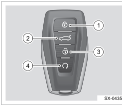
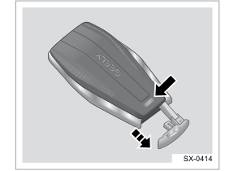
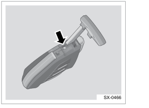
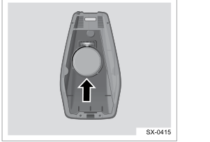

# Ключ Geely Coolray / Belgee X50: батарейка, «ключ не найден», автозапуск

Всё о штатном смарт-ключе: кнопки, замена батарейки, аварийный запуск, когда машина не видит ключ, дистанционный запуск двигателя и прописка нового ключа. Данные — из руководства по эксплуатации Coolray, Service Manual Geely Coolray 2019 и опыта владельцев из [Telegram-сообщества](https://t.me/CoolRay_Android_Develop). Основной текст — про дорестайлинговый Coolray и Belgee X50 в старом кузове; чем отличаются ключи Coolray 2023+, Belgee X50+ и нового X50 — [в отдельном разделе](#ключ-coolray-2023-belgee-x50-и-нового-belgee-x50).

<nav class="toc" id="оглавление" markdown="1">
## Оглавление
{:.no_toc .toc-title #toc-title}

* TOC
{:toc}
</nav>

## Кнопки ключа

{: width="245" height="210" loading="lazy"}

| № | Кнопка | Что делает |
| --- | --- | --- |
| 1 | Замок закрыт | запирает машину; удержание — поднимает стёкла |
| 2 | Багажник | открывает багажник |
| 3 | Замок открыт | отпирает машину; удержание — опускает стёкла |
| 4 | Круговая стрелка | [дистанционный запуск двигателя](#автозапуск-с-ключа); двойное нажатие — 3 сигнала и 3 мигания поворотников, чтобы найти машину |

Удержание кнопки запирания 10 секунд ставит машину на охрану без звука и мигания (Service Manual).

Внутри смарт-ключа спрятан механический ключ: нажмите кнопку на корпусе и вытяните его. Им отпирают водительскую дверь, если сел аккумулятор машины или не работает центральный замок, и включают детский замок задних дверей.

{: width="288" height="210" loading="lazy"}

_Схемы — из руководства по эксплуатации Geely Coolray, стр. 145–146._

Не носите смарт-ключ на одной связке с другими ключами с чипом (от другой машины, от домофона): по руководству, их микрочипы мешают иммобилайзеру и бесключевому доступу, и двигатель может не запуститься.

_[К оглавлению](#оглавление)_

## Батарейка ключа

| Параметр | Значение |
| --- | --- |
| Тип | CR2032, 3 В |
| Как ставить | плюсом (+) вниз |
| Норма напряжения | 2,17–3,6 В (по Service Manual) |

**Когда менять**, по руководству: заметно уменьшилось расстояние, с которого срабатывает ключ, перестало работать дистанционное управление или машина не распознаёт ключ. При низком заряде блок BCM записывает ошибки **B12B216** и **B12B316** («низкий заряд ключа 1/2») — их видно сканером.

По опыту владельцев, при разряде на приборной панели появляется жёлтый значок ключа; батарейка служит около 1,5–2 лет, и предупреждение появляется заранее.

### Как заменить батарейку

1. Достаньте механический ключ.
2. Вставьте его в среднее отверстие корпуса и, удерживая, поверните по часовой стрелке — задняя крышка откроется.

   {: width="301" height="218" loading="lazy"}

3. Замените батарейку: новая CR2032 ставится **плюсом вниз**.

   {: width="301" height="204" loading="lazy"}

4. Соедините две половинки корпуса до щелчка.

По опыту владельцев, отверстие для вскрытия — в проёме, откуда вынимается механический ключ, рядом надпись «OPEN»; с новой батарейки не забудьте снять защитную плёнку.

Перевёрнутая батарейка — частая ошибка. По опыту владельцев, ключ после этого перестаёт закрывать машину, а на приборке появляется «ключ не обнаружен»; завести можно только из аварийной зоны. Перевернули по значку «+» на стенке корпуса — всё заработало.

_[К оглавлению](#оглавление)_

## Пишет «ключ не найден»

Двигатель запускается, только если система видит действительный ключ в салоне. Иначе на приборной панели появляется сообщение, что ключа в автомобиле нет. Причины — разряженная батарейка ключа, неисправный ключ или радиопомехи.

Что делать по руководству:

1. **Положите ключ в зону аварийного пуска — на дно бокса центрального подлокотника** — и запустите двигатель кнопкой «Старт/Стоп». Там стоит антенна иммобилайзера, которая читает ключ даже с севшей батарейкой.
2. Не помогло — попробуйте **запасной ключ**. Заводится запасным — неисправен первый ключ. Не заводится ни одним — неисправна система, нужно к дилеру.
3. Уберите рядом с ключом другие ключи с чипом и электронику, которые могут создавать помехи.

Если сел аккумулятор машины, ключ не поможет: дверь открывают механическим ключом, а машину заводят от внешнего источника — см. [прикуривание](/pages/battery/#как-прикурить-от-другой-машины).

Неисправности системы бесключевого доступа BCM пишет кодами: B12A053 (двигатель не разблокирован, сбой авторизации), B12AD29 (нет ответа бесключевого запуска), B12B149 (обрыв антенны иммобилайзера), B128600–B12B000 (обрывы антенн в дверях, салоне, багажнике). Коды — по Service Manual.

_[К оглавлению](#оглавление)_

## Бесключевой доступ

- **Отпереть:** ключ не дальше 1,5 м от передней двери — коснитесь зоны датчика на ручке. Отпираются все двери, поворотники мигают 3 раза.
- **Запереть:** зажигание выключено, двери, капот и багажник закрыты, ключ снаружи — коснитесь зоны запирания на ручке. Поворотники мигают 1 раз. Следующие 5 секунд бесключевое отпирание не работает.
- **Автоповторное запирание:** отперли и за 30 секунд ничего не открыли — машина запрётся снова.
- Ключ остался в салоне или багажнике — при попытке запереть кнопкой на двери звучит сигнал, двери не запираются.

У Belgee X50 в базовой комплектации «Актив» бесключевого доступа нет.

_[К оглавлению](#оглавление)_

## Автозапуск с ключа

Двигатель можно завести с брелока, не подходя к машине:

1. Ключ — в зоне действия.
2. Нажмите кнопку дистанционного запуска (4), затем кнопку запирания (1).
3. Нажмите и удерживайте кнопку дистанционного запуска около 2 секунд.

**Заглушить** — снова нажать и удерживать кнопку дистанционного запуска. Кнопка «отпереть» в этом режиме отпирает машину.

Порядок — по руководству. В журнале «За рулём» и в чате описан вариант короче: нажать «запереть», затем удерживать кнопку запуска.

По опыту владельцев:

- двигатель работает **10 минут** и глохнет; запустить можно повторно — всего 2 × 10 минут, увеличить время штатно нельзя;
- климат включается сам в режиме AUTO, прошлые настройки не сохраняются, подогрев сидений не включается;
- головное устройство не загружается до тех пор, пока вы не сядете и не нажмёте тормоз.

На Coolray Link с конца 2022 года есть ещё запуск через приложение G-Link — по таймеру, температуре или заряду АКБ. Это отдельная функция, к ключу не относится.

_[К оглавлению](#оглавление)_

## Новый ключ и прописка

Потеряли или сломали ключ — по руководству, нужно к официальному дилеру. Дилер отвяжет потерянный ключ от машины, новый изготавливают не сразу.

Как прописывают ключи, по Service Manual:

- через диагностический разъём OBD сканером: BCM → Special function → **IMMO learning key** (ключ держат у антенны иммобилайзера) и **Remote learning key** (пульт);
- для обеих операций нужен **32-значный код ESK** — его выдаёт сервис производителя;
- к машине прописывается до **трёх** ключей;
- после замены блока ECM или BCM противоугонную систему согласуют заново с вводом ESK и перепрописывают ключи.

_[К оглавлению](#оглавление)_

## Ключ Coolray 2023+, Belgee X50+ и нового Belgee X50

Всё, что выше, — по руководству дорестайлингового Coolray (оно же подходит к Belgee X50 в старом кузове). Кнопки и батарейка CR2032 у новых версий те же, но корпус ключа открывается по-другому, а у Belgee другое место для аварийного запуска.

| Машина | Как открыть корпус | Ключ при «не найден» |
| --- | --- | --- |
| Coolray 2023 | механический ключ в прорезь посередине, повернуть по часовой | на метку ключа в отделении подлокотника |
| Coolray 2026 | ключ в отверстие на торце, повернуть по часовой | на метку ключа в отделении подлокотника |
| Belgee X50+ | ключ в отверстие сзади, **поддеть** крышку | **в подстаканник** в задней части центральной консоли |
| Belgee X50 2026 | поддеть крышку, сначала **вынуть чип** | в подстаканник в задней части консоли (в другом месте руководства — «внутри подлокотника») |

Батарейка у всех — CR2032; в руководстве Coolray 2023 сказано ставить её плюсом к задней крышке.

Аварийный запуск у всех: селектор в P или N, ключ на своё место, нажать тормоз и кнопку запуска. На приборке Coolray 2023 при этом пишет «Smart key is not detected».

У нового Belgee X50 после замены батарейки чип ставят обратно на заднюю крышку, со стороны логотипа, и защёлкивают половинки корпуса.

**Дверь механическим ключом.** Скважина — в задней части ручки водительской двери; против часовой стрелки — запереть, по часовой — отпереть. Если открыть дверь механическим ключом при севшей батарейке ключа, сработает сигнализация: выключить — нажать кнопку на ключе или перевести зажигание в ON (Coolray 2026, X50+, X50). У нового Belgee X50 личинка есть только у водительской двери: остальные двери запирают, вставив ключ в белую прорезь на торце двери и повернув вниз.

**Зимой** не оставляйте ключ надолго на холоде: может появиться предупреждение о разряде батарейки, хотя она в порядке (руководство Coolray 2023).

**Автозапуск** в руководствах Coolray 2023, Coolray 2026 и X50+ описан так: нажать «запереть», затем в течение 2 секунд нажать и удерживать кнопку дистанционного запуска. Число запусков подряд и время работы двигателя ограничены (Coolray 2026) — точных цифр руководство не даёт.

Как отличить версии — [Версии машины](/pages/versions/#как-отличить-дорестайлинг-от-рестайлинга).

_[К оглавлению](#оглавление)_

## Частые вопросы

### 🔋 Какая батарейка в ключе Geely Coolray?
CR2032 на 3 В. Ставится плюсом вниз — по руководству по эксплуатации.

### 🔓 Как открыть ключ, чтобы поменять батарейку?
Достаньте механический ключ, вставьте его в среднее отверстие корпуса и поверните по часовой стрелке — откроется задняя крышка. После замены соедините половинки до щелчка.

### 🔑 Что делать, если машина пишет «ключ не найден»?
Положите ключ на дно бокса центрального подлокотника — там зона аварийного пуска — и нажмите «Старт/Стоп». Если не заводится, попробуйте запасной ключ, затем — к дилеру.

### 📍 Куда класть ключ на Belgee X50+, если пишет «ключ не найден»?
В подстаканник в задней части центральной консоли (по руководству X50+), затем селектор в P или N, тормоз и кнопка запуска. У Coolray — на метку ключа в отделении подлокотника.

### 🗝️ Как открыть ключ Belgee X50+?
Выньте механический ключ, вставьте его в отверстие в задней части корпуса и, держа за рукоятку, подденьте заднюю крышку (по руководству X50+). Батарейка — CR2032.

### 📡 Как завести Coolray с брелока?
Нажмите кнопку дистанционного запуска, затем «запереть», потом удерживайте кнопку запуска около 2 секунд. Заглушить — снова удерживать кнопку запуска.

### ⏱️ Сколько работает двигатель после автозапуска?
По опыту владельцев — 10 минут, затем глохнет. Повторить можно ещё раз, всего 2 × 10 минут. Руководство Coolray 2026 подтверждает, что время работы и число запусков ограничены, но цифр не даёт.

### 💻 Можно ли самому прописать новый ключ?
Нужен диагностический сканер с функциями Geely и 32-значный код ESK от сервиса производителя. На практике ключи прописывает дилер.

_[К оглавлению](#оглавление)_

------

**Источники**

- Руководство по эксплуатации дорестайлингового Coolray: кнопки и механический ключ — стр. 145–146; замена батарейки — стр. 146; автозапуск — стр. 150.
- Service Manual Geely Coolray 2019: замена батарейки — раздел 11.9.6.1.
- [Руководство Coolray 2023](https://cdn.perxis.ru/originals/d1elmp8beucc73er1hd0/original): как открыть корпус и батарейка плюсом к крышке — стр. 111–112; ключ на холоде — стр. 112; аварийный запуск — стр. 121.
- [Руководство Coolray 2026](https://cdn.perxis.ru/originals/d8fd7tobeucc73ceqlf0/original): как открыть корпус — стр. 170; аварийный запуск — стр. 92; ограничения автозапуска — стр. 11; сигнализация при открытии механическим ключом — стр. 12.
- [Руководство Belgee X50+](https://cdn.perxis.ru/originals/d8632e8beucc73ceoa10/original): как открыть корпус — стр. 145; аварийный запуск — стр. 88; сигнализация — стр. 12.
- [Руководство Belgee X50 2026](https://cdn.perxis.ru/originals/db2g9t8beucc73boua9g/original): корпус и чип — стр. 83; аварийный запуск — стр. 63 (на стр. 12 — «внутри подлокотника»); двери механическим ключом — стр. 82–83; сигнализация — стр. 12.
- Статьи: [«За рулём»](https://www.zr.ru/content/articles/926671-5-fishek-geely-coolray/) — короткий вариант автозапуска; [auto.ru](https://auto.ru/mag/article/u-geely-coolray-v-rossii-poyavilas-komplektaciya-s-distancionnym-upravleniem/) — запуск через G-Link на Coolray Link.
- Опыт владельцев: значок разряда ключа — [пример в чате](https://t.me/CoolRay_Android_Develop/71060/453451); срок службы батарейки, надпись OPEN и защитная плёнка — Drive2 [1](https://www.drive2.ru/l/651338594740347345/), [2](https://www.drive2.ru/l/713527247285271090/); перевёрнутая батарейка — [обсуждение в чате](https://t.me/CoolRay_Android_Develop/60768/453601); автозапуск на 10 минут — чат [1](https://t.me/CoolRay_Android_Develop/60768/447331), [2](https://t.me/CoolRay_Android_Develop/169864/456612); климат при автозапуске — [обсуждение](https://t.me/CoolRay_Android_Develop/60768/458959); головное устройство при автозапуске — [обсуждение](https://t.me/CoolRay_Android_Develop/60768/465028).

[Аккумулятор](/pages/battery/) · [Предохранители](/pages/fuses/) · [Все запчасти и каталоги](/pages/parts/) · [Вернуться на главную](/)
