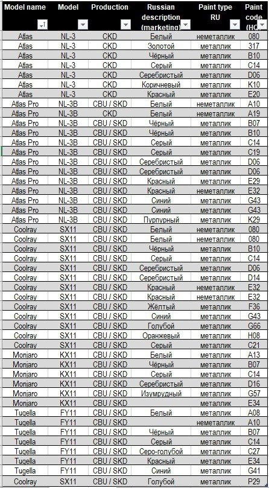

# Цвета кузова и коды краски Geely Coolray / Belgee X50

Официальные названия цветов, коды заводской краски (ЛКП) и в каких годах был каждый цвет — по прайсам и брошюрам Geely и Belgee. Код нужен, чтобы подобрать краску для подкраски сколов: карандаш, баллончик или краску на разлив.

## Таблица цветов и кодов краски

| Цвет | Название | Код | Был на |
| --- | --- | --- | --- |
| Белый (солид) | Crystal White | 080 (A08) | все Coolray и Belgee |
| Красный (солид) | Bright Vermilion | E32 | все Coolray, Belgee X50 (2024–2026), X50+ |
| Чёрный металлик | Ink Black | B07¹ | Coolray до 2023, Belgee X50 и X50+ (кроме комплектации «Престиж») |
| Серый металлик | Magnetic Grey | C21 | Coolray, Belgee X50, X50+ |
| Серый металлик | Basalt Grey | C14 | Belgee X50 (2026), X50+ |
| Серебристый металлик | Satin Silver | D14 | Coolray 2026, новый Belgee X50 |
| Серебристый металлик | Pearl Silver | D06 | Coolray до 2023, Belgee X50, X50+ |
| Синий металлик | Starry Night Blue | G43³ | Coolray до 2023, Belgee X50 (2026), X50+ |
| Голубой металлик | Fruit Blue, Cyber Blue | G66² | Coolray 2022–2025 |
| Голубой металлик | Aurora Blue | G77 | новый Belgee X50 (2026) |
| Оранжевый металлик | Freedom Orange | H08² | Coolray до 2023 |
| Жёлтый металлик | Imperial Yellow | F36² | Coolray до 2023 |
| Лиловый перламутр | Unicorn Grey | P36⁴ | Coolray 2023–2026, только Exclusive |

1. B07 указан в официальных прайсах Belgee 2026. В каталогах автоэмалей B10 — второй код того же чёрного ([vseautoemali](https://vseautoemali.ru/cars/geely/coolray)); B08 называют только владельцы — уточняйте у дилера.
2. Код или английское название взяты из каталогов автоэмалей и с форумов владельцев ([bamper99](https://bamper99.ru/geely-coolray-sx11-cveta), [Drive2](https://www.drive2.ru/l/674032789615567278/), [vseautoemali](https://vseautoemali.ru/cars/geely/coolray)), официально не подтверждены. Названия Magnetic Grey, Basalt Grey, Pearl Silver, Ink Black и Aurora Blue — официальные, из [пресс-релиза Belgee](https://belgee.ru/about-belgee/news/belgee-announces-start-production-and-exterior-of-new-x50/) о новом X50; в прайсах C14 и C21 — оба «Серый металлик», D06 и D14 — «Серебристый металлик».
3. G43 официально указан для Belgee X50+; для синего Coolray до 2023 года код официально не подтверждён.
4. P36 — по двум каталогам автоэмалей, где цвет назван Diamond Purple ([carross](https://www.carross.eu/en/paint-geely-coolray-m4200), [vseautoemali](https://vseautoemali.ru/cars/geely/coolray)); Geely код не публикует. Встречающийся код C44 не подтверждён.

Белый и красный в прайсах не названы металликом — это однотонная краска, в каталогах и на форумах её называют «солид». Доплаты за цвет нет ни в одном официальном прайсе.

<nav class="toc" id="оглавление" markdown="1">
## Оглавление
{:.no_toc .toc-title #toc-title}

* TOC
{:toc}
</nav>

## Цвета по годам

| Модель | Цвета |
| --- | --- |
| Coolray до рестайлинга (2020–2023) | белый, чёрный, красный, синий, серый, серебристый, оранжевый, жёлтый, голубой — 9 цветов в [прайсе на январь 2023](https://195004.selcdn.ru/ref/a2c7efc004d70eb0ffeef9788ab4c6b7cf275837.pdf) |
| Coolray после рестайлинга (2023–2025) | белый, красный, лиловый перламутр, серый, голубой — [прайс на апрель 2024](https://195004.selcdn.ru/ref/291da31728bdd41fa61d18266538f5addf2c9569.pdf) |
| Coolray 2026 | с мая 2026 — только лиловый перламутр, с 1 июля добавлены белый и серый ([autonews](https://www.autonews.ru/news/6a44d3eb9a7947cf3279e8f0)); в [брошюре на 25.08.2026](https://cdn.perxis.ru/originals/da61eo0beucc7399ar9g/original) — лиловый, красный, белый, серый, серебристый. Кодов в прайсе и брошюре Geely нет |
| Belgee X50 (2023–2025) | красный, серебристый, белый, чёрный, серый — [брошюра на 01.06.2024](https://avtoruss.ru/assets/files/booklets/belgee/belgee-brochure-x50.pdf), стр. 16 |
| Belgee X50 в старом кузове (2026) | 7 цветов: белый A08, чёрный B07, серый C21 и C14, красный E32, серебристый D06, синий G43 — [прайс на март 2026](https://alyans-belgee.ru/files/X50.pdf) |
| Новый Belgee X50 (2026) | белый A08/080, серый C21 и C14, чёрный B07, серебристый D06/D14, голубой G77 — [прайс с кодами](https://cdn.perxis.ru/originals/dbi9gv7vbdlg00bp61kg/original), [брошюра](https://cdn.perxis.ru/originals/dapu0ugbeucc7399i5pg/original), стр. 14 |
| Belgee X50+ (2026) | белый A08, серый C14 и C21, чёрный B07, серебристый D06, красный E32, синий G43 — [прайс с кодами](https://cdn.perxis.ru/originals/dbk84hvvbdlg00bp6fr0/original). Чёрный недоступен в комплектации «Престиж», спецверсия «Оникс» — только чёрная |

В белорусских прайсах Belgee цвета называются иначе: «Кристально-белый», «Ярко-красный», «Базальтово-серый металлик». Какая версия у вас — на странице [Версии машины](/pages/versions/).

### Чёрная крыша

Двухцветный кузов — это чёрная крыша и передние стойки при любом цвете кузова:
- Coolray до рестайлинга — пакет Flagship Sport;
- Coolray после рестайлинга — комплектации Flagship и Exclusive;
- Coolray 2026 — контрастная чёрная крыша по брошюре.

В официальных прайсах и брошюрах Belgee X50 двухцветной окраски нет. Код краски чёрной крыши ни в одном источнике не найден.

_[К оглавлению](#оглавление)_

## Где найти код краски

На Coolray и Belgee X50 нет таблички с кодом краски. Таблички на нижней части центральных стоек содержат VIN, производителя, массу и дату выпуска, а наклейка в проёме водительской двери — давление в шинах. Поля «код краски» нет ни на одной из них — так в руководстве по эксплуатации Coolray (стр. 18), в руководствах Coolray 2026 (стр. 203), X50+ (стр. 177) и нового X50 (стр. 115), и в [Service Manual](/assets/pdf/Service_Manual_2019.pdf) (раздел 1.9, стр. 1-54…1-61). Совет искать наклейку под запасным колесом владельцы Coolray [опровергли](https://www.drive2.ru/l/656068144007235329/): там только наклейка про нишу колеса, а наклейка с кодом лежит там у Geely Atlas ([geely-club.by](https://geely-club.by/viewtopic.php?t=1800)).

Поэтому код узнают:
- у дилера по VIN;
- по таблице выше, зная название цвета и год машины;
- компьютерным подбором в магазине автоэмалей.

По опыту владельцев, краска по коду может не совпасть по оттенку: серебристая D14 из магазина [не подошла по оттенку](https://t.me/CoolRay_Android_Develop/60768/448889). Для заметных мест надёжнее компьютерный подбор.

_[К оглавлению](#оглавление)_

## Таблица цветов других моделей Geely

Исходная таблица с кодами краски для Atlas, Atlas Pro, Coolray, Monjaro и Tugella:

{: width="446" height="809" loading="lazy"}

_[К оглавлению](#оглавление)_

## Частые вопросы

### Где находится код краски на Geely Coolray / Belgee X50?
Отдельной таблички с кодом краски на машине нет: заводские таблички на центральных стойках содержат VIN и массы, но не код ЛКП. Код узнают у дилера по VIN или по таблице цветов выше, а точный оттенок — компьютерным подбором.

### Какой код краски у белого Coolray — «белый солид»?
Белый Crystal White — код 080 (в прайсах Belgee — A08/080). Это неметаллик: однотонная краска без блёсток, её называют «солид». В каталогах автоэмалей тот же белый встречается как Athens White ([vseautoemali](https://vseautoemali.ru/cars/geely/coolray), [colorndrive](https://colorndrive.com/en/touch-up-paint/geely-all-chrystal-white-080,284808/details)).

### Какие коды краски у Belgee X50 и X50+?
По официальным прайсам на ноябрь 2026: белый A08 (080), серый металлик C21 и C14, чёрный металлик B07, серебристый металлик D06 (у нового X50 — D06/D14), у нового X50 голубой G77, у X50+ красный E32 и синий G43.

### Какой код краски у серого и серебристого Coolray?
Серый металлик — C21 (Magnetic Grey) или C14, серебристый металлик — D14 (Satin Silver) или D06. В официальных прайсах оба кода серого и оба кода серебристого указаны под одним названием, поэтому точный код уточняйте у дилера по VIN.

### Как подобрать краску для подкраски сколов?
По коду из таблицы подбирают карандаш, баллончик или краску на разлив. У одного цвета бывает два кода, а оттенок по коду может отличаться от заводского — для заметных мест лучше компьютерный подбор.

### Чем Belgee X50 отличается от Geely Coolray по краске?
Кузов тот же (SX11), коды общие: белый 080, красный E32, серый C21; серебристый у Coolray — D14, у Belgee X50 по прайсам — D06. У Belgee не было оранжевого, жёлтого и лилового цветов, зато у нового X50 (2026) есть голубой металлик G77.

------

[Все запчасти и каталоги](/pages/parts/) · [Вернуться на главную](/)
