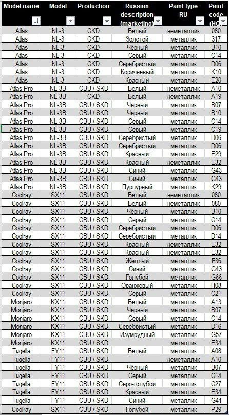

# Коды краски Geely Coolray / Belgee X50

Коды заводской краски (ЛКП) и названия цветов для кузова SX11 — по ним подбирают краску для подкраски сколов, карандаш или баллончик для ремонта. Перед покупкой сверьте код с вашим автомобилем у дилера или в магазине автоэмалей.

| Цвет | Тип краски | Код |
| --- | --- | --- |
| Белый | неметаллик | 080 |
| Чёрный | металлик | B10 |
| Серый | металлик | C14 |
| Серый | металлик | C21 |
| Серебристый | металлик | D06 |
| Серебристый | металлик | D14 |
| Красный | неметаллик | E32 |
| Жёлтый | металлик | F36 |
| Синий | металлик | G43 |
| Голубой | металлик | G66 |
| Голубой | металлик | P29 |
| Оранжевый | металлик | H08 |

## Таблица цветов других моделей Geely

Исходная таблица с кодами краски для Atlas, Atlas Pro, Coolray, Monjaro и Tugella:

{: width="446" height="809" loading="lazy"}

------

[Все запчасти и каталоги](/pages/parts/) · [Вернуться на главную](/)
