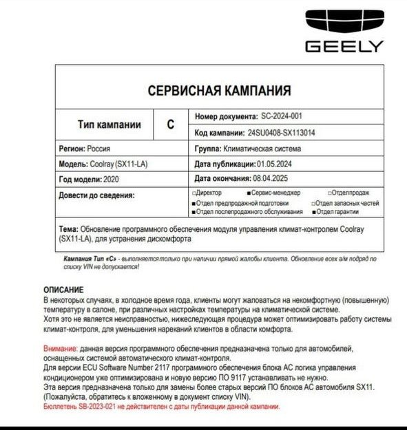
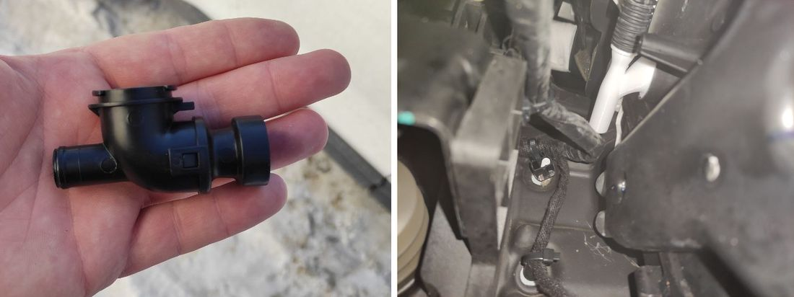
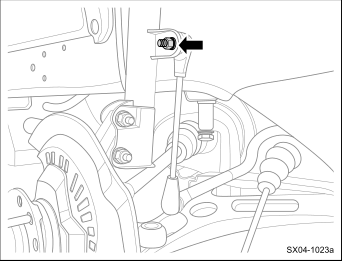
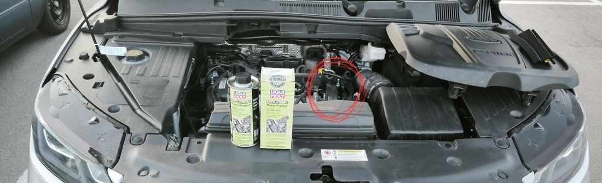
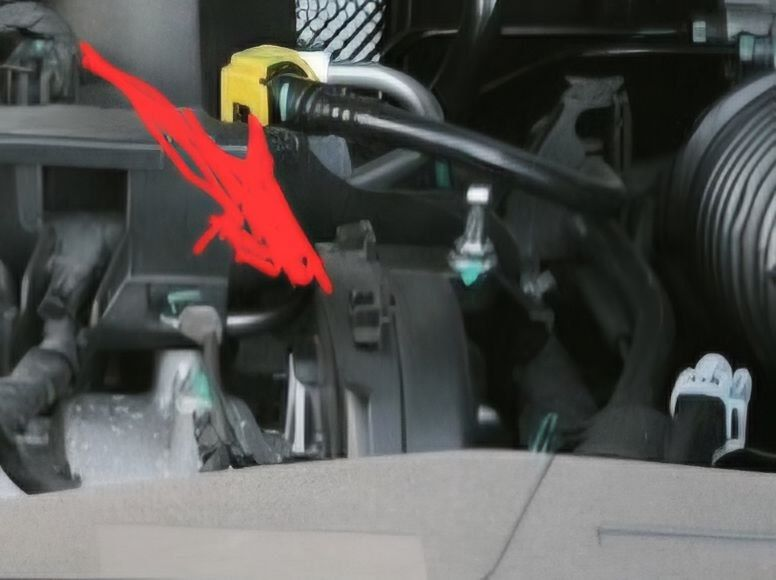
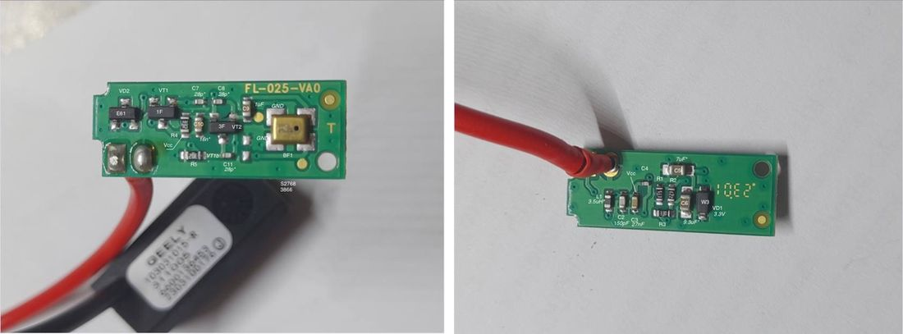
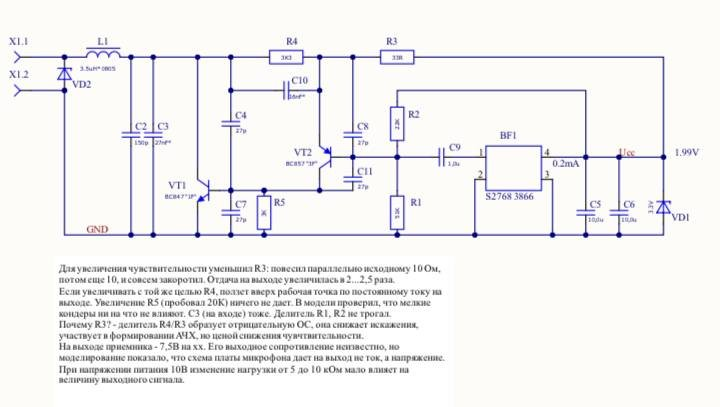
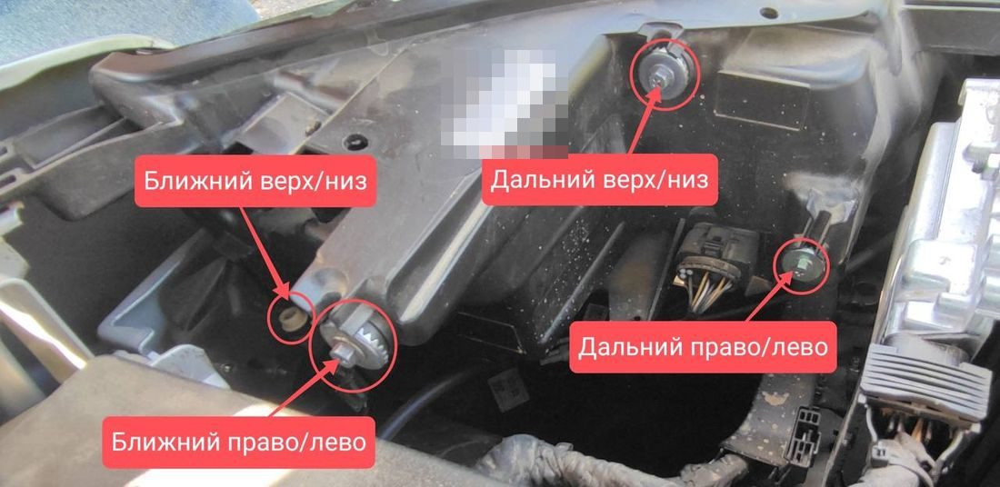

# Проблемы и решения Geely Coolray / Belgee X50
Короткие инструкции для типичных ситуаций: как понять причину, что проверить в первую очередь и какие шаги помогут решить проблему без лишних затрат.

<nav class="toc" id="оглавление" markdown="1">
## Оглавление
{:.no_toc .toc-title #toc-title}

* TOC
{:toc}
</nav>

## Коробка не переключает скорости вверх
Поехал по делам, и смотрю что скорости выше 2й не переключаются. Попереживал. Скинул клеммы, проверил рычаг селектора, расстроился. Случайно заметил постоянно горящие стопы, осмотрел лягушку, увидел неисправность. **Итого**: отвалилась шайбочка резиновая на педали тормоза, под лягушкой, из за этого постоянно стопы горели и передачи не переключились.

## Уводит машину в сторону (новая/после салона)
**Проблема:** авто тянет влево/вправо, после обычного сход-развала эффект возвращается.

**Причина:** криво выставлен подрамник с завода → одно переднее колесо «опережает» другое.

**Диагностика (быстро):**

1. На стоящем авто измерить расстояние от края переднего колеса до крыла/бампера слева и справа.
2. Разница ~5–7 мм и более — признак смещённого подрамника.

**Решение:**

1. На подъёмнике ослабить болты крепления подрамника.
2. Монтажками выровнять подрамник по кузову (ходов хватает).
3. Затянуть болты с нужным моментом.
4. Повторно выполнить сход-развал.

**Результат:** увод пропадает, повторного ухода не возникает.

## «Жарит» климат
**Симптом:** в холодное время в салоне слишком жарко при разных настройках температуры.

**Решение 1 — прошивка у дилера.** Обновить ПО блока климат-контроля до **версии 9117**. Это сервисная кампания Geely **SC-2024-001** для Coolray (SX11); в заказ-наряде работа называется «SX88600011 Обновление программного обеспечения модуля управления климат-контролем SX11».

- Кампания типа «C»: её делают **только по жалобе клиента** — так и скажите мастеру-приёмщику.
- Только для машин с **автоматическим климат-контролем**.
- Если в блоке уже стоит ПО **2117**, обновлять не нужно — логика там уже исправлена.

{: width="591" height="625" loading="lazy"}

**Решение 2 — альтернативный тройник.** Заменить родной тройник системы климата на альтернативный (переходник для климата Geely Tugella/Coolray). Слева — родной, справа — установленный альтернативный (белый). Где искать и как ставить — [на Drive2](https://www.drive2.ru/l/661962350965829110/).

{: width="1100" height="412" loading="lazy"}

## Вентилятор радиатора включается на пару секунд и выключается
**Симптом:** с включённым кондиционером вентилятор охлаждения запускается на 2–5 секунд и замолкает; в жару в пробке двигатель греется до 105 °C.

**Причина:** не работает первая скорость вентилятора — чаще всего сгорел её резистор. Обычная диагностика ошибку не показывает.

**Решение 1 — по гарантии.** Попросите дилера принудительно включить первую скорость вентилятора через Launch (тест исполнительных механизмов). Если она не включается, вентилятор меняют в сборе — так владельцы добивались гарантийной замены даже после ответа «всё работает штатно».

**Решение 2 — заменить резистор.** Ремкомплект **Luzar LFR 3023** (резистор и две гильзы) встаёт на штатное место:

1. Снимите пластиковую накладку и корпус воздушного фильтра — к вентилятору удобно подойти сверху.
2. Откусите провода старого резистора.
3. Соедините провода нового резистора гильзами, обожмите их и заизолируйте, как было.

Работа занимает 30–60 минут, вентилятор снимать не нужно. Отчёты владельцев — в [Telegram-чате](https://t.me/CoolRay_Android_Develop/71060/457280).

## Стук и скрип в подвеске

Что чаще всего стучит и скрипит спереди и как найти источник. Данные — из Service Manual Geely Coolray 2019 (раздел 4 «Подвеска»), отчётов на Drive2, Drom и Авто.ру и опыта владельцев из чата.

| Симптом | Что проверить первым |
| --- | --- |
| Скрип на морозе, на лежачих, при раскачке и крене | **втулки переднего стабилизатора** |
| Стук на мелких неровностях; скрип или стук, который меняется при повороте руля в движении | **стойки стабилизатора** |
| Скрип в одну сторону под нагрузкой на колесо, в сухую погоду или на морозе | **задние сайлентблоки передних рычагов** |
| Щелчки или хруст при повороте руля **на месте**, звук сверху стойки | **опорный подшипник и опора стойки** |
| Глухой стук спереди на разбитой дороге, зимой сильнее | передние амортизаторы, опора стойки |
| Глухой стук сзади на кочках | сначала **запаска и инструмент в багажнике**, замок и петли двери багажника; затем задние амортизаторы |
| Скрип пропадает при нажатии на тормоз | это тормоза, а не подвеска |

**Порядок поиска шума спереди по Service Manual:** смазка шаровых опор → износ деталей подвески → сайлентблоки нижних рычагов → затяжка стоек стабилизатора → амортизаторы и подушки пружин → посадка пружин → втулки стабилизатора → сравнение с исправной машиной той же модели.

### Втулки стабилизатора

Service Manual прямо называет их первым подозреваемым, если спереди шумит **в холодную погоду**. Заводской способ: снять втулку, обмотать стабилизатор липкой лентой и поставить втулку обратно. Проверить можно, побрызгав на втулки мыльным раствором или силиконовой смазкой: скрип пропал или изменился — дело в них ([обсуждение](https://t.me/CoolRay_Android_Develop/60768/441585), [ещё одно](https://t.me/CoolRay_Android_Develop/71060/445925)). Втулки скрипят в движении при крене; на месте при повороте руля они молчат ([обсуждение](https://t.me/CoolRay_Android_Develop/71060/453754)).

Оригинальную втулку отдельно не нашли — ни в каталоге, ни у владельцев; часто меняют стабилизатор в сборе. По Service Manual стабилизатор снимают вместе с передним подрамником, кронштейны втулок затягивают моментом **30 Н·м**.

### Стойки стабилизатора

Сначала стойка скрипит, позже начинает стучать на неровностях. Найти просто: положите руку на стойку под крылом, а помощник пусть крутит руль на заведённой машине. Стойка реагирует на руль, потому что верхним концом крепится к амортизатору, а он поворачивается вместе с колесом ([обсуждение](https://t.me/CoolRay_Android_Develop/60768/446222), [ещё одно](https://t.me/CoolRay_Android_Develop/71060/459227)). По отчётам владельцев, стойки меняли на пробегах от 17 до 146 тыс. км, родные доживали до 90 тыс.

{: width="342" height="261" loading="lazy"}

_Верхняя гайка стойки стабилизатора на амортизаторе (стрелка). Схема из Service Manual Geely Coolray 2019._

Оригинальный номер стойки — **4015011100**. Обе гайки стойки затягивают моментом **65 Н·м** (60–70 Н·м по Service Manual).

### Сайлентблоки передних рычагов

Задний сайлентблок переднего рычага теряет эластичность и скрипит под нагрузкой на колесо — на кочке или в повороте, в сухую погоду сильнее. У одного из владельцев скрип при повороте вправо искали в рейке, опорниках и стойках, а оказался левый сайлентблок; его видно при вывернутом колесе ([обсуждение](https://t.me/CoolRay_Android_Develop/71060/458925)). На подъёмнике звук может пропасть, потому что подвеска разгружена: слушать лучше на яме — один крутит руль, второй слушает.

### Опорный подшипник и опора стойки

Щёлкает или хрустит сверху стойки при повороте руля, в том числе на месте. Опорные подшипники, по отчётам владельцев, меняют в районе 60–110 тыс. км. Оригинальный номер подшипника по каталогу — 4013022600; перед заказом сверьте по VIN. Верхние гайки стойки к кузову — **35 Н·м**.

Если стучит опора о чашку кузова, часть владельцев ставит проставки 5 мм под опору ([опыт владельца](https://t.me/CoolRay_Android_Develop/439580/450999)). Это доработка владельцев, а не процедура Geely.

### Нужен ли сход-развал

По Service Manual — после замены рулевых наконечников, тяг или пыльника рейки. После замены стоек и втулок стабилизатора регулировка углов не требуется. Если для замены стабилизатора снимали подрамник, проверить углы разумно.

### Что скажет дилер

По опыту владельцев, по одной жалобе на звук детали по гарантии не меняют — нужна видимая неисправность: люфт, разрыв, течь ([обсуждение](https://t.me/CoolRay_Android_Develop/71060/457311), [ещё одно](https://t.me/CoolRay_Android_Develop/71060/441809)). Небольшое запотевание амортизатора Service Manual считает допустимым. Сроки гарантии на детали подвески — на странице [гарантии](/pages/warranty/).

## Предохранители
Схемы блоков в моторном отсеке и в салоне с расшифровкой каждого предохранителя — на отдельной странице [Предохранители](/pages/fuses/).
Обсуждение на форуме: [geely-club.by](https://geely-club.by/viewtopic.php?f=279&t=1869)

## «Отвал» стеклоподъёмника
**Быстрый сброс блока:** вынуть **пред. №33 (30A)** «стеклоподъёмники» → через 10–15 сек вставить обратно.

## Форсунки омывателя
**Обратный клапан:** оригинал Geely **6025023800**, аналог Toyota **8532126020**  
Подробнее: [Drive2](https://www.drive2.ru/parts/toyota-lexus/8532126020/B9bjwEAAGmM)

## Скрипит люк при закрытии
**Уход:** смазка подвижных частей и резинок **каждые ~6 мес или 5 000 км**. Для резинок — силиконовая смазка.  
Подробнее: [Drive2](https://www.drive2.ru/l/643905621258679023/)

## Замена тормозных колодок / биение дисков
**Симптом:** к ~20 000 км возможны биения передних дисков.  
**Решение:** замена дисков/колодок, корректная прикатка (bed-in) после установки.  
Подробнее: [Drive2](https://www.drive2.ru/l/663420578262173512/)

## Регистрация китайских ГУ
**Кратко:** нужен WeChat, сервис **eSender** для получения китайского номера (SMS).  
Есть бесплатный номер на 7 дней, далее — платно (цены зависят от тарифа сервиса).

## Модем 4G в машину
**Цель:** постоянный интернет для ГУ без раздачи с телефона.

**Пример (Huawei E3272h-153):**
1. Прошить **HiLink** (с Web UI) по инструкции (см. 4PDA).
2. В Web UI перевести режим c **NDIS** (Windows) на **CDC** (совместимо с ГУ).
3. Поставить **Auto-switch = 1 сек** (по умолчанию 30 сек).
4. Перезагрузить модем. В Windows как сетевой интерфейс он больше не появится — это нормально.
5. Подключить к ГУ в любой USB-порт и настроить доступ в интернет.

## Сервисный режим дворников
Если после выключения зажигания опустить рычаг стеклоочистителей вниз, щётки выполнят половину цикла и остановятся в вертикальном положении. Это удобно для обслуживания или в снегопад — щётки не примерзнут к стеклу.

## Режим “Проводи меня светом” (Follow Me Home)
После выключения двигателя потяни левый рычаг дальнего света на себя на 2 секунды — фары загорятся.
Закрой машину — фары останутся включёнными ~30 секунд (время настраивается).

## Стук под капотом
В районе бачков омывателя и охлаждающей жидкости патрубок соприкасается с пластиковой крышкой, из-за чего слышен стук в салоне справа.
Решение: проложить участок поролоном или проклеить антискрип-лентой/зафиксировать — шум исчезает.

{: width="1100" height="335" loading="lazy"}

{: width="776" height="580" loading="lazy"}

## Плохо слышно собеседника по громкой связи
**Симптом:** вы собеседника слышите хорошо, а он вас — плохо и тихо.

**Причина:** низкая чувствительность штатного микрофона в потолочном плафоне (плата FL-025-VA0).

**Решение:**

1. Снимите верхний плафон и достаньте плату микрофона.
2. Найдите резистор **R3** — он стоит в цепи обратной связи усилителя и снижает чувствительность.
3. Закоротите R3 перемычкой или замените на резистор **0 Ом** того же размера.
4. Соберите в обратном порядке.

**Результат:** громкость микрофона вырастает примерно в 2–2,5 раза — собеседник хорошо слышит даже с заднего сиденья.

{: width="1100" height="407" loading="lazy"}

{: width="720" height="407" loading="lazy"}

## Как отрегулировать фары (LED)
Регулировочные винты находятся сверху и сзади на корпусе фары (под капотом). Для каждого режима два винта:

| Винт | Что регулирует |
| --- | --- |
| Ближний — верх/низ | высота луча ближнего света |
| Ближний — право/лево | направление ближнего света |
| Дальний — верх/низ | высота луча дальнего света |
| Дальний — право/лево | направление дальнего света |

Регулируйте на ровной площадке перед стеной или экраном, с водителем в машине и полным баком.

{: width="1100" height="536" loading="lazy"}

## Полезные отчёты владельцев

Проверенные отчёты с Drive2, форума Geely Club и YouTube — по темам.

| Тема | Отчёт |
| --- | --- |
| 💨 Свист на скорости | [Свист на скорости — побеждён (уплотнители)](https://www.drive2.ru/l/673565222295836999/) |
| 🔊 Стук и дребезг | [Стуки спереди (амортизаторы)](https://www.drive2.ru/l/695441105642083104/) · [Стук и металлическое дребезжание — форум](https://geely-clubs.ru/forums/topic/1443-stuk-i-metallicheskoe-drebezzhanie-coolray/) |
| 🔧 Подвеска | [Замена тяг стабилизатора на Lemförder](https://www.drive2.ru/l/641595822206635602/) |
| ❄️ Климат | [Исправление «адского» климата — перенос подачи воздуха на датчик](https://www.drive2.ru/l/634769504265578164/) · [Дренажная трубка кондиционера](https://www.drive2.ru/l/616404636424737281/) |
| 🌫️ Запотевание | [Запотевание стёкол и фар — форум](https://geely-clubs.ru/forums/topic/1505-zapotevanie-stekol-i-far-coolray/) |
| 🌬️ Салонный фильтр | [Замена фильтра кондиционера — видео](https://youtu.be/_YZ8z9scV8E) |
| 🧽 Дворники | [Замена резинок дворников](https://www.drive2.ru/l/639760737299872019/) |
| ⚙️ Коробка | [Замена масла в бачках актуатора РКПП](https://www.drive2.ru/l/690536459148463278/) |
| ⏱️ ГРМ | [Замена ГРМ пораньше — выбор запчастей](https://www.drive2.ru/l/684993821032850536/) |
| 🔐 Замки | [Проблемы с центральным замком](https://www.drive2.ru/l/665037410110812506/) |
| 📡 Брелок | Дальность штатного брелка — доп. антенна блока (на примере Monjaro): [1](https://www.drive2.ru/l/666358473331596058/), [2](https://www.drive2.ru/l/665877711872339528/) |
| 🔥 Сиденья | [Обогрев сидений при автозапуске](https://www.drive2.ru/l/663313375878457174/) |
| ⚡ Предохранители | [Схема предохранителей и реле](https://www.drive2.ru/l/620210595924349687/) |
| 📹 Регистратор | [Установка регистратора](https://www.drive2.ru/l/600288269862717385/) |
| 🔋 Беспроводная зарядка | [Ставим беспроводную зарядку — видео](https://youtu.be/Zuuc2CGQbXQ) |

_[К оглавлению](#оглавление)_

## Что означают значки на приборной панели
Расшифровка всех 27 контрольных ламп и индикаторов — на отдельной странице [Значки на приборной панели](/pages/warning-lights/).

------

[Вернуться на главную](https://qttc.github.io/)

