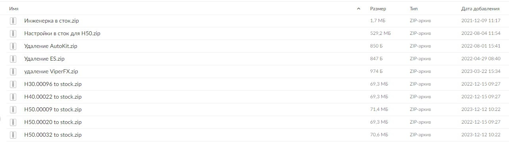

# Как вернуть заводскую прошивку ГУ (откат Community)

Если нужно убрать Community и вернуть магнитолу в заводское состояние — например, перед визитом к дилеру по гарантии на ГУ или перед продажей машины.

<nav class="toc" id="оглавление" markdown="1">
## Оглавление
{:.no_toc .toc-title #toc-title}

* TOC
{:toc}
</nav>

## Когда нужен откат

- 🛠️ **Гарантия по ГУ.** Если идёте к дилеру с проблемой магнитолы (камеры, экран и т.п.) — сначала откатитесь в сток. С остальными проблемами дилеры обычно не обращают внимания на Community.
- 🚗 **Продажа машины** или передача другому владельцу.
- ⚠️ **Глюки после экспериментов**, которые не лечатся перезагрузкой. Если ГУ вообще не загружается — сначала [пакет Last Chance](#если-гу-не-загружается-пакет-last-chance).

_[К оглавлению](#оглавление)_

## Пошаговая инструкция

1. Узнайте версию прошивки ГУ — [как узнать версию ПО](/pages/community/#как-узнать-версию-по-в-машине). Нужна часть после буквы H, например H50.00032.
2. Скачайте архив отката **для своей версии** — из таблицы ниже или в боте [@Coolray_Community_helper_bot](https://t.me/Coolray_Community_helper_bot): «У меня уже прошито Community» → «Откатиться в сток».
3. Если на ГУ стоит **KingRoot** с root-правами — сначала снимите их: KingRoot → три точки справа сверху → Настройки → Удалить Root-права → Продолжить → снимите галку «Сохр. резервн. копию root» → ОК.
4. Распакуйте архив в корень флешки (FAT32) и вставьте её в любой USB-порт машины.
5. Подождите 5–7 минут, пока пройдёт откат.

{: width="1283" height="366" loading="lazy"}

_[К оглавлению](#оглавление)_

## Архивы полного отката

Для полного отката нужен **только один архив** — «H… to stock.zip» вашей версии. Все архивы лежат [одним постом в чате](https://t.me/CoolRay_Android_Develop/76794/414422).

| Версия ГУ | Архив | Размер |
| --- | --- | --- |
| H30.00071 | H30.00071 to stock.zip | 72,9 МБ |
| H30.00096 | H30.00096 to stock.zip | 69,2 МБ |
| H30.00108 | H30.00108 to stock.zip | 75,1 МБ |
| H40.00022 | H40.00022 to stock.zip | 70,6 МБ |
| H50.00009 | H50.00009 to stock.zip | 71,4 МБ |
| H50.00020 | H50.00020 to stock.zip | 70,6 МБ |
| H50.00022 | H50.00022 to stock.zip | 70,6 МБ |
| H50.00032 | H50.00032 to stock.zip | 70,6 МБ |

💡 Нет вашей версии — спросите в боте или в [чате](https://t.me/CoolRay_Android_Develop).

_[К оглавлению](#оглавление)_

## Частичный откат

Если нужно убрать только одну часть Community, а остальное оставить. Для полного отката эти архивы **не нужны**.

| Что убрать | Архив | Скачать |
| --- | --- | --- |
| ES Проводник | Удаление ES.zip (847 Б) | [с сайта](/assets/files/rollback/remove-es.zip) · [из чата](https://t.me/CoolRay_Android_Develop/76794/414412) |
| ViPER4Android | Удаление ViperFX.zip (3 КБ) | [с сайта](/assets/files/rollback/remove-viperfx.zip) · [из чата](https://t.me/CoolRay_Android_Develop/76794/414413) |
| AutoKit | Удаление AutoKit.zip (850 Б) | [с сайта](/assets/files/rollback/remove-autokit.zip) · [из чата](https://t.me/CoolRay_Android_Develop/76794/414423) |
| Навигацию на приборке | Откат IPKServer.zip (6,7 МБ) | [с сайта](/assets/files/rollback/ipkserver-rollback.zip) · [из чата](https://t.me/CoolRay_Android_Develop/76794/414422) |

Ставятся так же, как полный откат: распакуйте архив в корень флешки (FAT32) и вставьте её в машину. После удаления ES и AutoKit магнитола сама перезагрузится. Откат IPKServer есть только для версий H40.00022, H50.00009, H50.00020, H50.00022 и H50.00032 — на H30 он не сработает.

Откат IPKServer возвращает стоковый сервис навигации — он помогает на ГУ H50, если стрелки на приборке не появляются ([подробнее](/pages/cluster-navigation/#если-стрелки-не-появляются)).

Пакеты «Инженерка в сток» и «Настройки в сток для H50» — в боте, в разделе отката.

_[К оглавлению](#оглавление)_

## Если ГУ не загружается: пакет Last Chance

Last Chance — последний шанс для магнитолы, которая зависла на загрузке или бесконечно перезагружается (бутлуп), например после неудачной установки Community или отката. Пакет делает полный сброс ГУ к заводским настройкам с флешки — то же, что сброс в меню, только меню для этого открывать не нужно.

| Архив | Скачать |
| --- | --- |
| Last_chance.zip (655 Б) | [с сайта](/assets/files/rollback/last-chance.zip) · [из чата](https://t.me/CoolRay_Android_Develop/60768/461183) |

Как поставить:
1. Распакуйте архив в корень флешки (FAT32). На флешке должна оказаться папка `b832bc61472727635baffcf25dd28e9f239273e2` — не переименовывайте её: через неё ГУ запускает скрипт.
2. Вставьте флешку в USB-порт машины при включённом зажигании и дождитесь, пока магнитола перезагрузится.
3. Сразу после перезагрузки выньте флешку: в скрипте нет защиты от повторного запуска, и сброс сработает снова.

Что удаляет сброс:
- все настройки ГУ и установленные приложения (раздел `/data`), в том числе программы Community;
- системные файлы, изменённые Community, остаются — сброс не заменяет [архив полного отката](#архивы-полного-отката).

Что внутри архива

Один скрипт `d4ad0e797c738a44a9dd1b9231d201e8374dfda2.sh`. Он отправляет системе команду сброса `am broadcast -a android.intent.action.MASTER_CLEAR` и записывает `SUCCESS` в файл `USBDETECTED.log` на флешке.

### Что делать после сброса

- **Интерфейс на английском.** По опыту владельцев, язык возвращают через меню приборной панели: переключить язык на английский, обратно на русский и перезагрузить ГУ ([пример из чата](https://t.me/CoolRay_Android_Develop/60762/443809)).
- **Пропали приложения Community.** Установите пакет Community поверх ещё раз — так же, как ставили его в первый раз ([из чата](https://t.me/CoolRay_Android_Develop/60762/455316)).
- **QDLink снова просит активацию.** По опыту владельцев, лицензия QDLink после сброса слетает ([из чата](https://t.me/CoolRay_Android_Develop/60762/443308)). Перед активацией проверьте дату на приборке — с неверной датой [активация не проходит](/pages/community/#почему-после-установки-community-сбивается-дата-на-2016-год).

💡 Если и после Last Chance ГУ не загружается — пишите в [чат](https://t.me/CoolRay_Android_Develop) с версией ГУ и описанием, на каком шаге всё сломалось.

_[К оглавлению](#оглавление)_

------

[Прошивки Community](/pages/community/) · [Вернуться на главную](/)
