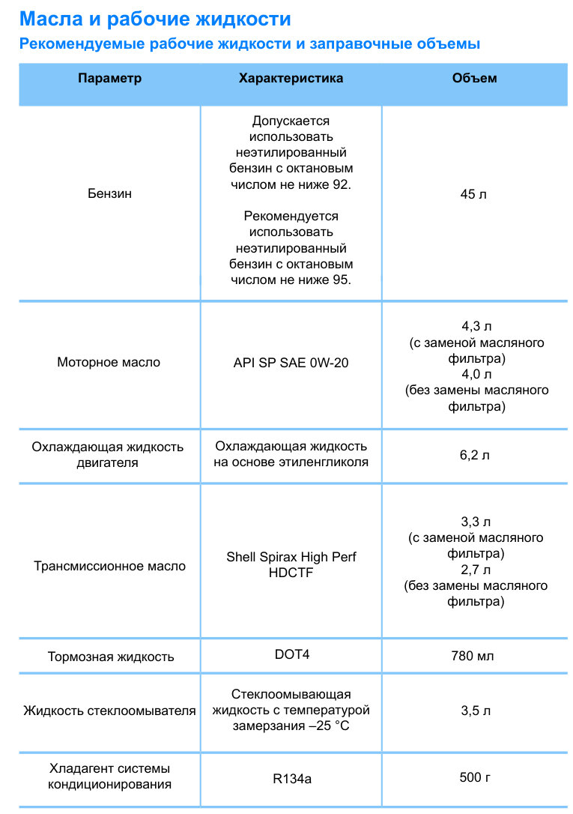
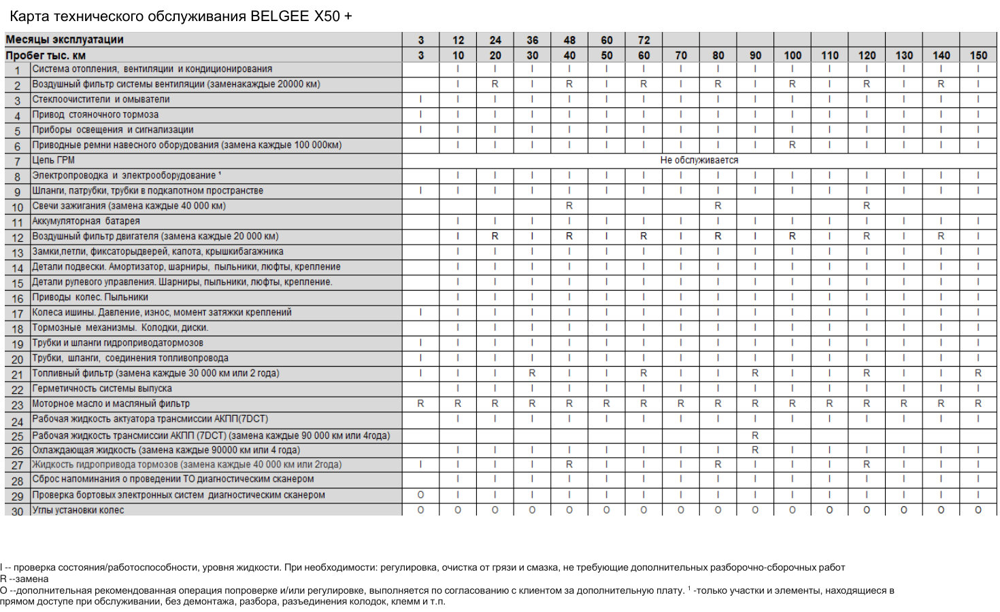

{::options toc_levels="2" /}

# ТО и жидкости рестайлинга: Geely Coolray 2023+, Belgee X50+, Coolray 2026

Сколько масла и других жидкостей заливать в машины с 4-цилиндровым мотором 1,5 л (BHE15) и что и когда менять по официальным картам ТО. Всё — по руководствам по эксплуатации и картам ТО Geely и Belgee, со страницами.

## Для каких машин эта страница

| Машина | Годы | Мотор | Коробка |
| --- | --- | --- | --- |
| **Geely Coolray** (рестайлинг) | октябрь 2023 — осень 2025 | BHE15-AFZ, 147 л. с.; в руководстве также BHE15-EFZ | робот 7DCT |
| **Belgee X50+** | с весны 2026 | BHE15-AFZ, 147 л. с. | робот 7DCT |
| **Geely Coolray** (второй рестайлинг) | с весны 2026 | BHE15-AFZ, 147 л. с. | робот 7DCT |
| **Belgee X50** (новый, атмосферный) | 2026 | BHE15-AFD, 122 л. с., без турбины | автомат 6AT |

У всех этих машин **4 цилиндра**. Если у вас **3-цилиндровый мотор** JLH-3G15TD и экран магнитолы 10,25″ — это дорестайлинговый Coolray 2020–2023 или Belgee X50 в старом кузове: для него [масло и жидкости](/pages/oil/) и [регламент ТО](/pages/to/) на отдельных страницах. Как отличить версии по фонарям и салону — [Версии машины](/pages/versions/#как-отличить-дорестайлинг-от-рестайлинга).

| | Каждые | Что менять |
| --- | --- | --- |
| 🛢️ | 10 000 км / 12 мес. | масло и масляный фильтр (4,3 л) |
| 🌬️ | 20 000 км | салонный и воздушный фильтры |
| ⛽ | 30 000 км / 2 года | топливный фильтр |
| ⚡ | 40 000 км | свечи зажигания |
| 🛑 | 40 000 км / 2 года | тормозная жидкость |
| 💧 | 90 000 км / 4 года | антифриз и масло в коробке 7DCT |
| 🔧 | 100 000 км | приводной ремень навесного оборудования |
{:.summary}

<nav class="toc" id="оглавление" markdown="1">
## Оглавление
{:.no_toc .toc-title #toc-title}

* TOC
{:toc}
</nav>

## Масло и жидкости: объёмы

| Что | Coolray 2023–2025 | Belgee X50+, Coolray 2026 | Belgee X50 атмосферный |
| --- | --- | --- | --- |
| Моторное масло | API SP 0W-20, 4,3 л с фильтром / 4,0 л без | API SP 0W-20, 4,3 л (сухой двигатель) / 4,0 л (сервисный объём) | API SP 0W-20 или 5W-40, 4,3 / 4,0 л |
| Антифриз | 6,2 л, на основе этиленгликоля | 6,2 л, одобренный Geely / Belgee | 6,8 л, сертифицированный Belgee |
| Тормозная жидкость | DOT4, 0,78 л | DOT4, 0,78 л | DOT4, 0,85 л |
| Масло в коробке | Shell Spirax High Perf HDCTF, 3,3 л с фильтром / 2,7 л без | не указано | не указано |
| Омыватель | 3,5 л, жидкость до −25 °C | X50+ — 4,5 л; Coolray 2026 — 3,5 или 4,5 л | 5 л |
| Хладагент кондиционера | R134a, 500 г | не указан | не указан |
| Бензин | рекомендуется АИ-95, допускается АИ-92; бак 45 л | то же | то же |

Источники: руководство по эксплуатации Coolray 2023 ([PDF](https://cdn.perxis.ru/originals/d1elmp8beucc73er1hd0/original)), стр. 231; Coolray 2026 ([PDF](https://cdn.perxis.ru/originals/d8fd7tobeucc73ceqlf0/original)), стр. 207; Belgee X50+ ([PDF](https://cdn.perxis.ru/originals/d8632e8beucc73ceoa10/original)), стр. 180; нового Belgee X50 ([PDF](https://cdn.perxis.ru/originals/db2g9t8beucc73boua9g/original)), стр. 120.

{: width="765" height="1086" loading="lazy"}

_Таблица из [руководства по эксплуатации Geely Coolray 2023](https://cdn.perxis.ru/originals/d1elmp8beucc73er1hd0/original), стр. 231._

В руководствах для этих моторов указаны только класс API SP и вязкость — допусков ACEA и производителя, как у старого мотора JLH, там нет. Таблицы вязкости по температуре тоже нет. Про масло в коробку и как его менять — на странице [Коробка 7DCT](/pages/dct/#какие-коробки-бывают-на-coolray-и-belgee-x50).

💡 Цифры 4,3 и 4,0 л руководства объясняют по-разному: у Coolray 2023 — «с заменой фильтра / без замены», у X50+ и Coolray 2026 — «сухой двигатель / сервисный объём». При замене ориентируйтесь на щуп.

_[К оглавлению](#оглавление)_

## Регламент ТО по карте

Интервалы из официальных карт технического обслуживания ООО «Джили-Моторс»: Coolray SX11-A5 ([карты ТО Geely](https://cdn.perxis.ru/originals/da45sm8beucc7399alvg/original), стр. 1–2) и Belgee X50+ ([карты ТО Belgee](https://cdn.perxis.ru/originals/d76hiugbeucc73cefk60/original), стр. 4) — они совпадают. Первое ТО — через 3 месяца или 3 000 км, дальше каждые 10 000 км или раз в год, что наступит раньше.

| Что менять | Интервал |
| --- | --- |
| Моторное масло и масляный фильтр | каждые 10 000 км или 12 месяцев (первая замена — на ТО через 3 000 км) |
| Салонный фильтр | каждые 20 000 км |
| Воздушный фильтр двигателя | каждые 20 000 км; при пыли и на песчаных дорогах — каждые 10 000 км |
| Топливный фильтр | каждые 30 000 км или 2 года |
| Свечи зажигания | каждые 40 000 км |
| Тормозная жидкость | каждые 40 000 км или 2 года |
| Охлаждающая жидкость (антифриз) | каждые 90 000 км или 4 года |
| Масло в коробке 7DCT | каждые 90 000 км или 4 года |
| Приводной ремень навесного оборудования | каждые 100 000 км |
| Цепь ГРМ | не обслуживается |

На каждом ТО по карте проверяют тормоза, подвеску, рулевое, приводы, шины, шланги, электрику и аккумулятор, смазывают замки и петли, а сканером сбрасывают напоминание о ТО.

{: width="1470" height="901" loading="lazy"}

_Карта ТО Belgee X50+ из [регламента ТО Belgee](https://cdn.perxis.ru/originals/d76hiugbeucc73cefk60/original), стр. 4. R — замена, I — проверка, O — по желанию за доплату._

**Тяжёлые условия.** Если машина ездит в пыли, подолгу работает на холостых или низких оборотах, в жару, в мороз на короткие расстояния или в горах, масло и фильтр карта велит менять «каждые 10 000 км или чаще», а приводной ремень — проверять каждые 10 000 км. Отдельного числа (например, 7 500 км) в карте нет.

**Салонный фильтр CN95.** Если стоит фильтр CN95, его противовирусная фильтрация рассчитана на 8 000 км или 9 месяцев.

**Coolray 2023.** У рестайлинга своя карта — SX11-A3 ([карты ТО Geely](https://cdn.perxis.ru/originals/da45sm8beucc7399alvg/original), стр. 18): интервалы в названиях строк те же, что выше, плюс проверка ЭРА-ГЛОНАСС на каждом ТО. Отметки в сетке этой карты местами расходятся с названиями строк (антифриз, тормозная жидкость, масло в коробке и топливный фильтр отмечены чаще) — уточняйте у дилера, по какой сетке он работает.

**Атмосферный Belgee X50.** Карты ТО для него (SX11-A6, мотор BHE15-AFD, коробка 6AT) в регламентах Geely и Belgee пока нет.

_[К оглавлению](#оглавление)_

## Чем отличается от дорестайлинга

| | Coolray 2020–2023, Belgee X50 (JLH-3G15TD) | 4-цилиндровые BHE15 |
| --- | --- | --- |
| ГРМ | ремень, замена каждые 100 000 км | цепь, не обслуживается |
| Масло в моторе | 5,6 л | 4,3 / 4,0 л |
| Антифриз | 6,5 л, каждые 40 000 км или 2 года | 6,2 л (атмосферный — 6,8 л), каждые 90 000 км или 4 года |
| Масло в коробке | DCTF, 4,0 л | HDCTF, 3,3 л с фильтром (Coolray 2023) |
| Бензин | АИ-92 и выше | рекомендуется АИ-95 |

Остальные интервалы — масло, фильтры, свечи, тормозная жидкость — одинаковые. Данные по старому мотору — на страницах [Масло и жидкости](/pages/oil/) и [ТО и расходники](/pages/to/).

_[К оглавлению](#оглавление)_

## Как проверить уровень масла

По руководству Coolray 2026 (стр. 190): прогрейте мотор до рабочей температуры (около 90 °C), заглушите и подождите 10 минут, затем проверьте щуп. Доливайте примерно до 3/4 между отметками MIN и MAX. По руководству Coolray 2023 (стр. 210): после долива дайте мотору 3 минуты поработать на холостых, подождите ещё 10 минут и проверьте снова.

Расход масла больше 1 л на 1 000 км — повод обратиться к дилеру; в период обкатки повышенный расход — норма (Coolray 2023, стр. 210; Coolray 2026, стр. 191).

Зимой: мотор рассчитан на запуск до −35 °C; там, где бывает ниже −30 °C, руководство советует держать машину в гараже (Coolray 2023, стр. 203–204).

_[К оглавлению](#оглавление)_

## Тормозная жидкость и антифриз

- **Тормозная жидкость** — только DOT4 и только из нераспечатанной ёмкости; перед тем как открыть бачок, очистите крышку. Даже капля минерального масла повреждает тормозную систему. Уровень немного падает по мере износа колодок — это нормально; резкое падение — признак утечки, тогда загорается лампа тормозной системы (Coolray 2023, стр. 215–216).
- **Антифриз** — только одобренный Geely (у Belgee — сертифицированный Belgee): карта ТО предупреждает, что другая жидкость может серьёзно повредить мотор и систему охлаждения. У атмосферного X50 руководство запрещает смешивать жидкости разных производителей (стр. 120).
- **Омыватель** — температура замерзания жидкости должна быть на 10 °C ниже самой низкой температуры в вашем регионе (Coolray 2026, стр. 193).

_[К оглавлению](#оглавление)_

## Частые вопросы

### Сколько масла в моторе Geely Coolray 2023 и Belgee X50+?
4,3 л с заменой фильтра и 4,0 л без замены — по руководству Coolray 2023 (стр. 231). Для X50+ и Coolray 2026 руководства дают те же 4,3 / 4,0 л. Масло — API SP 0W-20.

### Какое масло заливать в рестайлинговый Coolray и X50+?
API SP с вязкостью 0W-20. У атмосферного Belgee X50 2026 руководство допускает также 5W-40.

### Как часто менять масло на Belgee X50+?
Каждые 10 000 км или раз в 12 месяцев, что наступит раньше; первая замена — на ТО через 3 000 км или 3 месяца. В тяжёлых условиях — чаще.

### Когда менять антифриз на Coolray 2023 и X50+?
Каждые 90 000 км или 4 года — по картам ТО Coolray SX11-A5 и Belgee X50+. У старого 3-цилиндрового мотора — каждые 40 000 км или 2 года.

### Есть ли ремень ГРМ у рестайлингового Coolray?
Нет. У 4-цилиндровых моторов BHE15 цепь ГРМ, по картам ТО она не обслуживается. Ремень ГРМ с заменой каждые 100 000 км — только у дорестайлингового Coolray и Belgee X50 с 3-цилиндровым мотором.

### Какой бензин заливать в Belgee X50+?
Руководство рекомендует АИ-95 и допускает АИ-92. Бак — 45 л.

_[К оглавлению](#оглавление)_

------

[Все запчасти и каталоги](/pages/parts/) · [Вернуться на главную](/)
