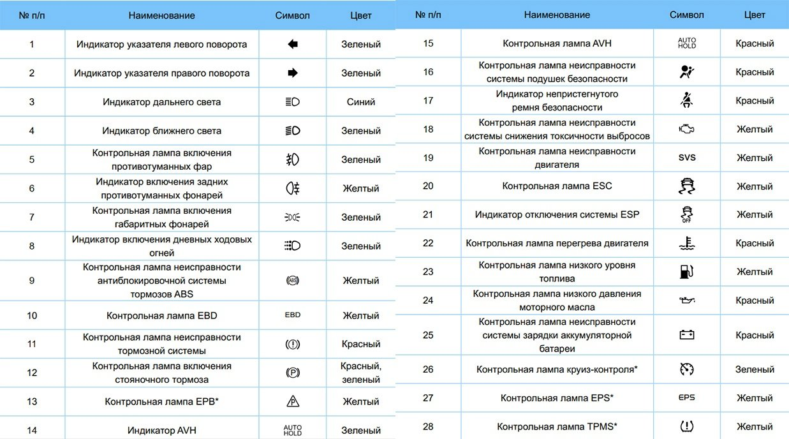

# Значки на приборной панели Belgee X50 / Geely Coolray: что означают

Загорелся значок на приборной панели и непонятно, что он означает и можно ли ехать дальше? Ниже — расшифровка всех обозначений: что значит каждая контрольная лампа и индикатор, по таблице из руководства по эксплуатации. Belgee X50 — это Coolray белорусской сборки, поэтому таблица подходит для обеих машин. Значки со звёздочкой (\*) есть не во всех комплектациях.

**Как понимать цвет:**

- 🔴 **Красный** — неисправность или опасность: остановитесь и разберитесь, прежде чем ехать дальше.
- 🟡 **Жёлтый** — предупреждение: система работает неправильно или отключена, проверьте при первой возможности.
- 🟢 **Зелёный или синий** — просто показывает, что функция включена.

<nav class="toc" id="оглавление" markdown="1">
## Оглавление
{:.no_toc .toc-title #toc-title}

* TOC
{:toc}
</nav>

## 🔴 Красные лампы

| Лампа | Что означает |
| --- | --- |
| (!) в круге | неисправность тормозной системы |
| (P) в круге | включён стояночный тормоз (бывает и зелёным) |
| AUTO HOLD | неисправность системы AVH (удержание на месте) |
| человечек с подушкой | неисправность подушек безопасности |
| человечек с ремнём | не пристёгнут ремень безопасности |
| термометр в жидкости | перегрев двигателя |
| аккумулятор | неисправность системы зарядки аккумулятора |

_[К оглавлению](#оглавление)_

## 🟡 Жёлтые лампы

| Лампа | Что означает |
| --- | --- |
| ABS в круге | неисправность антиблокировочной системы ABS |
| EBD | неисправность системы распределения тормозных усилий EBD |
| P в треугольнике | неисправность электронного стояночного тормоза EPB\* |
| двигатель (контур мотора) | неисправность системы снижения токсичности выбросов («Check Engine») |
| SVS | неисправность двигателя |
| машина с волнистыми следами | контрольная лампа системы стабилизации ESC |
| машина со следами и OFF | система ESP отключена |
| бензоколонка | низкий уровень топлива |
| маслёнка | низкое давление моторного масла |
| EPS | неисправность электроусилителя руля EPS\* |
| (!) в шине | давление в шинах TPMS\* |
| фара со штрихами справа | включены задние противотуманные фонари |

_[К оглавлению](#оглавление)_

## 🟢 Зелёные и синие индикаторы

| Индикатор | Что означает |
| --- | --- |
| стрелки влево / вправо | указатели поворота |
| фара с прямыми лучами (синий) | включён дальний свет |
| фара с наклонными лучами | включён ближний свет |
| фара со штрихами слева | включены передние противотуманные фары |
| два фонарика | включены габаритные огни |
| фара с точками | включены дневные ходовые огни |
| AUTO HOLD | система AVH включена |
| спидометр со стрелкой | включён круиз-контроль\* |

_[К оглавлению](#оглавление)_

## Предупреждения TPMS и электроручника

Некоторые значки сопровождаются сообщением на экране приборов и звуковым сигналом. Что они означают — по руководству по эксплуатации.

### Давление в шинах (TPMS)

| Что видно на экране | Что это значит |
| --- | --- |
| мигает значок шины, предупреждение о низком давлении | давление в шине ниже нормы — проверьте и подкачайте |
| мигает значок, 3 звуковых сигнала, подсвечена шина | давление выше нормы или высокая температура шины |
| значок горит, 3 сигнала, мигает символ одной шины | неисправность датчика или сел его элемент питания |
| нет данных о давлении | приборы не получают сигнал от блока TPMS |

Показания точны до 0,1 бар. После запуска двигателя приборы сначала показывают давление с прошлой поездки, а реальные значения появляются, когда машина едет быстрее 40 км/ч около минуты.

**Зимние колёса без датчиков.** TPMS сочтёт это неисправностью датчиков. По руководству, предупреждение отключается в меню бортового компьютера — включится зимний режим. По опыту владельцев, такого пункта есть не на всех машинах: тогда предупреждение убирают кодировкой блоков сканером Launch.

После перестановки колёс или установки запасного колеса показания давления на нём будут неверными, пока систему не инициализируют в сервисе.

### Электронный стояночный тормоз (EPB)

- **Красная (P)** — стояночный тормоз включён. Если после включения EPB значок не загорелся — нужна проверка в сервисе.
- **Жёлтый значок EPB** — неисправность электроручника или снижение его эффективности. Обратитесь в сервис; на стоянке подложите упоры под задние колёса.
- **Режим мойки:** чтобы EPB не включился сам при выключении зажигания, перед выключением нажмите и удерживайте кнопку EPB.

Если электроручник не работает совсем, проверьте предохранители SB02 и SB03 в моторном отсеке — схема на странице [Предохранители](/pages/fuses/).

_[К оглавлению](#оглавление)_

## Таблица из руководства

Полная таблица со значками из руководства по эксплуатации:

{: width="1237" height="688" loading="lazy"}

_[К оглавлению](#оглавление)_

## Что делать дальше

- 🛢️ Горит **маслёнка** или сомневаетесь в масле — объёмы, допуски и проверенные масла собраны в [Масло, антифриз и тормозная жидкость](/pages/oil/).
- 🔧 **Check Engine, SVS** или значок не гаснет — частые неисправности и их решения в [Проблемы и решения](/pages/problems/).
- 🧰 Нужны артикулы и каталоги для ремонта — [Запчасти и каталоги](/pages/parts/).
- 🔌 Не работает фара, прикуриватель или стеклоподъёмник — схемы и расшифровка в [Предохранители](/pages/fuses/).
- 🗓️ Подошёл пробег очередного ТО — регламент, фильтры и артикулы в [ТО и расходники](/pages/to/).

_[К оглавлению](#оглавление)_

## Частые вопросы

### Можно ли ехать, если горит красный значок?
Красный цвет — неисправность или опасность. Остановитесь в безопасном месте и разберитесь с причиной, прежде чем ехать дальше. Особенно это важно для значков тормозной системы, перегрева двигателя (термометр), низкого давления масла (маслёнка) и зарядки аккумулятора.

### Что делать, если загорелся жёлтый значок?
Жёлтый — предупреждение: система работает неправильно или отключена. Чаще всего ехать можно, но проверьте машину при первой возможности или заедьте на диагностику.

### Почему горит значок двигателя (Check Engine)?
Значок в виде контура двигателя — неисправность в системе управления двигателем или снижения токсичности выбросов. Причин много: от датчика или свечей до качества топлива. Нужна компьютерная диагностика, чтобы считать код ошибки. Типовые случаи — в [Проблемы и решения](/pages/problems/).

### Что означает значок маслёнки?
Красная маслёнка — низкое давление моторного масла. Это опасно для двигателя: как можно скорее остановитесь, заглушите мотор и проверьте уровень масла. Про объём и допуски — [Масло и жидкости](/pages/oil/).

### Что значит восклицательный знак в шине?
Это индикатор системы контроля давления в шинах (TPMS). Проверьте давление во всех колёсах и подкачайте до нормы; знак может загораться и из-за похолодания.

### Горит ошибка TPMS после установки зимних колёс — что делать?
Если на зимних колёсах нет датчиков давления, система считает это неисправностью. Отключите предупреждение в меню бортового компьютера — включится зимний режим. Если датчики есть, но давление показывается неверно после перестановки колёс, систему нужно инициализировать в сервисе.

### Что значит жёлтый значок электроручника (EPB)?
Неисправность электронного стояночного тормоза или снижение его эффективности. Обратитесь в сервис, а на стоянке подкладывайте упоры под задние колёса. Если EPB не работает совсем — проверьте предохранители SB02 и SB03 в моторном отсеке ([схема](/pages/fuses/)).

_[К оглавлению](#оглавление)_

------

[Проблемы и решения](/pages/problems/) · [Вернуться на главную](/)
